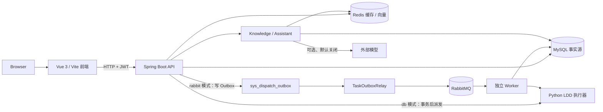
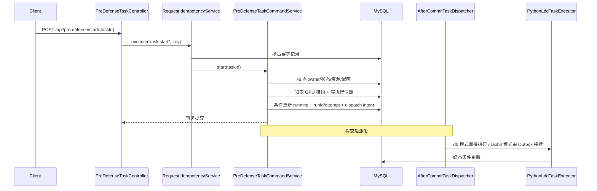
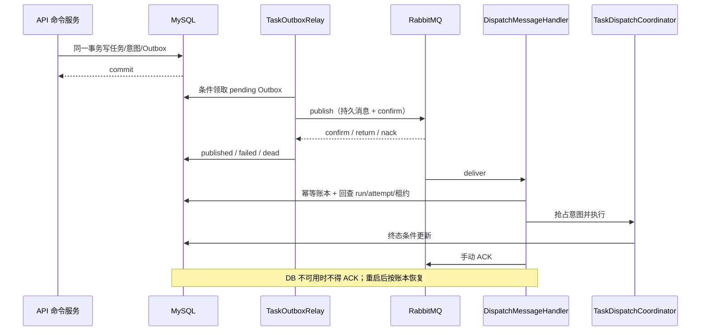
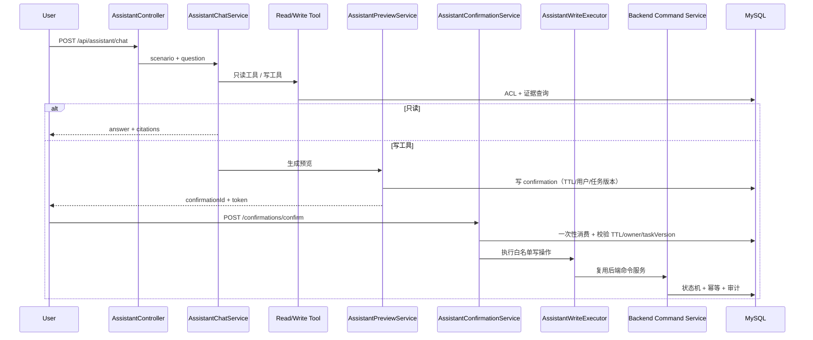

# 源码学习路线：从系统全貌到关键实现

> 本路线面向第一次接触本仓库的开发者。它不是 SDD 的替代品，而是把“读哪份设计、看哪个类、跑哪条测试、回答什么问题”串起来。
> 当前状态、测试数字和验收边界只引用 [`../sdd/26-current-delivery-facts.md`](../sdd/26-current-delivery-facts.md)。

## 0. 使用方式

建议按章节顺序读，每章只做三件事：

1. 先读“建议阅读顺序”里的 1–2 份文档，建立边界。
2. 打开列出的源码路径，沿着方法调用读，不要求一次读完整个包。
3. 跑对应测试或命令，用输出验证你读到的行为。

每章末尾的“读完后应能回答”用于自检；答不上来就回到源码和测试，不要凭印象补结论。

---

## 1. 系统架构、模块边界与本地启动

### 建议阅读顺序

1. [`../sdd/01-system-scope.md`](../sdd/01-system-scope.md)：系统目标、角色、闭环和非目标。
2. [`../sdd/03-target-architecture.md`](../sdd/03-target-architecture.md)：目标架构和任务生命周期。
3. 本文 §1 的组件图，再进入代码。

### 总体组件/进程架构



关键边界：

- API 只负责命令、权限、状态机和事实落库，不把 RabbitMQ 当事实源。
- `db` 模式：`AfterCommitTaskDispatcher` 在事务提交后把任务交给有界 `taskAsync` 线程池。
- `rabbit` 模式：API 在业务事务内写 `sys_task_dispatch_intent` 和 `sys_dispatch_outbox`；Relay 发布，Worker 消费。
- Python 只通过执行器协议交互；Java 不直接依赖 PyTorch 对象。
- Assistant 只能调用白名单工具；写工具只生成预览和一次性确认，最终仍调用后端命令服务。

### 源码入口

- Web 层：`migration-backend/src/main/java/com/securitymodel/interfaces/web`
- 应用层：`migration-backend/src/main/java/com/securitymodel/application`
- 领域模型：`migration-backend/src/main/java/com/securitymodel/domain`
- 基础设施：`migration-backend/src/main/java/com/securitymodel/infrastructure`
- 前端：`migration-frontend/src/views`、`migration-frontend/src/api`
- Python：`algorithm-runtime/vab/algorithm_entry.py`
- 启停与验收：`scripts/dev`、`scripts/r4`

### 构建/启动入口

```powershell
mvn -B -f migration-backend/pom.xml test
npm --prefix migration-frontend ci
npm --prefix migration-frontend run build
python -m unittest discover -s algorithm-runtime/vab/tests
```

启动说明见根 [`README.md`](../../README.md) 和 [`../sdd/24-stage3-single-node-deployment.md`](../sdd/24-stage3-single-node-deployment.md)。

### 能证明行为的测试

- `migration-backend/src/test/java/com/securitymodel/config/ApplicationConfigurationTest.java`
- `migration-backend/src/test/java/com/securitymodel/application/task/SchedulingReadinessHealthIndicatorTest.java`
- `migration-backend/src/test/java/com/securitymodel/infrastructure/cache/ResourceCatalogCacheTest.java`

### 读完后应能回答

1. 为什么 MySQL 是唯一事实源，Redis 和 RabbitMQ 各自不能证明什么？
2. `db` 与 `rabbit` 两种模式下，谁真正启动 Python 进程？
3. 前端、API、Worker、Python 之间的信任边界在哪里？
4. 哪些页面只是演示，不进入真实执行链路？

### 已知限制

- 当前只支持单机实验平台；不是多机、HA 或生产部署。
- 训练中/训练后页面是展示结构，不创建真实任务。
- 外部模型默认关闭，不能把本地检索结果写成“真实模型联调”。

---

## 2. 核心领域模型、任务状态机、run/attempt、快照与幂等

### 建议阅读顺序

1. [`../sdd/03-target-architecture.md`](../sdd/03-target-architecture.md) 的任务生命周期。
2. [`../sdd/05-decisions.md`](../sdd/05-decisions.md) 中状态机、执行协议、恢复相关 ADR。
3. 源码：领域模型 → 命令服务 → 幂等服务。

### 状态机与三个标识

- 任务状态：`pending → running → success | failed | canceled`。
- `run_id`：一次“从启动到终态”的运行标识；重试生成新 `run_id`。
- `attempt`：同一任务内的执行次数；重试递增，旧 attempt 的回调必须被拒绝。
- `execution_snapshot`：启动时冻结的数据集、算法、超参、执行器配置和指纹。
- 终态更新使用数据库条件更新，不能只靠 JVM 内存判断“当前执行”。

### 源码路径

- `migration-backend/src/main/java/com/securitymodel/domain/task/PreDefenseTask.java`
- `migration-backend/src/main/java/com/securitymodel/domain/task/TaskDispatchIntent.java`
- `migration-backend/src/main/java/com/securitymodel/domain/task/DispatchOutbox.java`
- `migration-backend/src/main/java/com/securitymodel/domain/task/DispatchConsumption.java`
- `migration-backend/src/main/java/com/securitymodel/domain/task/RequestIdempotencyRecord.java`
- `migration-backend/src/main/java/com/securitymodel/application/task/PreDefenseTaskCommandService.java`
- `migration-backend/src/main/java/com/securitymodel/application/task/RequestIdempotencyService.java`
- `migration-backend/src/main/java/com/securitymodel/application/task/TaskDispatchIntentService.java`
- `migration-backend/src/main/java/com/securitymodel/application/task/TaskDispatchCoordinator.java`

### API、表与消息契约

- API：`POST /api/pre-defense`、`POST /api/pre-defense/start/{taskId}`、`POST /api/pre-defense/retry/{taskId}`、`POST /api/pre-defense/cancel/{taskId}`。
- 表：`sys_pre_defense`、`sys_task_dispatch_intent`、`sys_request_idempotency`、`sys_dispatch_outbox`、`sys_dispatch_consumption`。
- 幂等键：`Idempotency-Key` 按 `owner_user_id + operation + key` 唯一；同键同体返回已存响应，同键异体或处理中返回 409。
- Outbox 事件：`DispatchEvent`，只带定位和幂等字段，不带路径、命令、凭据或完整参数。

### 能证明行为的测试

- `migration-backend/src/test/java/com/securitymodel/application/task/RequestIdempotencyServiceTest.java`
- `migration-backend/src/test/java/com/securitymodel/application/task/TaskDispatchIntentServiceTest.java`
- `migration-backend/src/test/java/com/securitymodel/application/task/PreDefenseTaskCommandServiceTest.java`
- `migration-backend/src/test/java/com/securitymodel/application/task/MySqlTaskPersistenceIT.java`

### 读完后应能回答

1. 为什么“消息已 ACK”不等于“任务已成功”？
2. 重试时哪些字段必须变化，哪些必须保持不变？
3. 同一个 `Idempotency-Key` 在什么情况下返回旧响应，什么情况下返回 409？
4. 旧 attempt 的回调为什么不能覆盖新任务？

### 已知限制

- 状态机不提供业务补偿事务；执行器失败后的结果仍要由命令服务按状态收敛。
- 幂等记录有保留/清理任务，不能假设永久保存。
- `run_id`/`attempt` 只能防止并发覆盖，不能替代算法内部可复现性。

---

## 3. 创建、预检、启动、重试、取消：API 到服务层

### 建议阅读顺序

1. `PreDefenseTaskController` 的端点。
2. `PreDefenseTaskCommandService` 的 `create/update/delete/start/retry/cancel`。
3. `validateDraft` 与 `plan`，再看 `TaskExecutionPlan` / `LddConfigurationPolicy`。

### API 到服务层流程



### 关键点

- `create` 只创建 `pending` 任务，不领取租约、不产生 run/attempt。
- `validateDraft` / `plan` 是服务端权威预检入口；Assistant 的参数校验工具复用同一策略，不允许前端自定义“可执行”结论。
- `start` 与 `retry` 都必须重新校验资源、执行器配置、配额、租约和状态。
- `cancel` 是状态收敛 + 取消派发/进程处置，不等于“立即杀死任意进程”。
- 更新/删除受 owner 和状态约束；运行中任务不能随意修改关键参数。

### 源码路径

- `interfaces/web/PreDefenseTaskController.java`
- `interfaces/web/PreDefenseReportController.java`
- `application/task/PreDefenseTaskCommandService.java`
- `application/task/LddConfigurationPolicy.java`
- `application/task/TaskExecutionPlan.java`（若类名随重构变化，以 `plan` 返回类型为准）
- `application/task/TaskExecutionQuotaPolicy.java`
- `application/task/GpuLeaseService.java`

### 能证明行为的测试

- `PreDefenseTaskCommandServiceTest`
- `TaskCommandServicePipelineIT`
- `LddConfigurationPolicyTest`
- `ValidateLddParametersToolTest`
- `OwnershipEndToEndIT`、`OwnershipHttpContractTest`

### 读完后应能回答

1. 创建任务时为什么不启动执行器？
2. 预检和启动分别校验了哪些条件？哪些校验只在前端做是不够的？
3. 重试与取消竞争时，哪一个数据库条件保证不会双启动？
4. 哪些操作必须带 `Idempotency-Key`？

### 已知限制

- 预检不是独立 HTTP 端点；它由命令服务计划和 Assistant 工具暴露，不要误写成“前端预检即权威”。
- 预检通过不代表 GPU 一定可用；启动时仍要领取租约。
- 真实 GPU 的取消/超时/重试行为未在本轮验证。

---

## 4. MySQL 持久化、事务边界、GPU 租约与配额

### 建议阅读顺序

1. `PreDefenseTaskCommandService.start/retry/cancel` 的事务边界。
2. `PreDefenseTaskMapper`、`GpuLeaseMapper` 的条件 SQL。
3. `GpuLeaseService`、`TaskExecutionQuotaPolicy`。

### 事务边界

- 任务状态、执行快照、调度意图、Outbox 必须在同一业务事务内落库。
- 事务提交前不启动 Python；`db` 模式用 after-commit 派发，`rabbit` 模式用 Relay 发布。
- 终态更新带 `task_id + run_id + attempt` 条件；更新 0 行表示迟到/旧执行，不能覆盖当前状态。
- 租约领取/续租/释放是独立的条件更新；未确认退出不释放槽位。

### 表与源码

- `sql/security_model_gpu_lease.sql`：`sys_gpu_lease`
- `sql/security_model_gpu_lease_block.sql`：`blocked_at` / `blocked_reason`
- `migration-backend/src/main/java/com/securitymodel/infrastructure/persistence/mapper/PreDefenseTaskMapper.java`
- `migration-backend/src/main/java/com/securitymodel/infrastructure/persistence/mapper/GpuLeaseMapper.java`
- `migration-backend/src/main/java/com/securitymodel/application/task/GpuLeaseService.java`
- `migration-backend/src/main/java/com/securitymodel/application/task/GpuLeaseHeartbeat.java`
- `migration-backend/src/main/java/com/securitymodel/application/task/TaskExecutionQuotaPolicy.java`

### 能证明行为的测试

- `GpuLeaseServiceTest`、`GpuLeaseHeartbeatTest`、`GpuLeaseBlockedProbeTest`
- `GpuLeaseMySqlIT`
- `TaskExecutionQuotaPolicyTest`
- `MySqlTaskPersistenceIT`

### 读完后应能回答

1. 为什么任务状态和 Outbox 要在同一个事务里？
2. `blocked_at` 与普通失败有什么区别？为什么 TTL 过期不自动解除隔离？
3. 配额和 GPU 并发控制是不是同一件事？
4. 终态条件更新返回 0 行时应该怎么处理？

### 已知限制

- 单槽租约只解决单机串行，不是分布式 GPU 调度。
- 配额是任务准入，不是 GPU 并发上限。
- 生产库 `eladmin` 未迁移；不要用默认旧库做实验。

---

## 5. Outbox、RabbitMQ Relay、Worker 消费、恢复与死信重放

### 建议阅读顺序

1. [`../sdd/21-r4-outbox-rabbitmq-design.md`](../sdd/21-r4-outbox-rabbitmq-design.md) 的契约、状态表和 §16 验收表。
2. `TaskOutboxService` → `TaskOutboxRelay` → `DispatchMessageHandler`。
3. `WorkerConsumerLifecycle` / `DispatchRecoveryCoordinator` / `DispatchOperationsService`。

### Outbox 派发与 Worker 恢复时序



### 关键机制

- 至少一次投递，不做 exactly-once；业务幂等靠 MySQL 账本和 `run_id + attempt`。
- 重复投递只 ACK，不提前终结原账本。
- 不可路由/confirm 丢失/延迟 confirm 都要落到明确状态，不能靠“没收到异常”推断成功。
- 死信不是自动重跑；管理员通过 `POST /api/observability/dispatch/dead/{messageId}/replay` 显式重放。
- Worker 启动要过数据库/租约/执行器/归属门；DB 恢复后不能盲目重放已 submitted 的意图。

### 源码路径

- `application/task/TaskOutboxService.java`
- `application/task/TaskOutboxRelay.java`
- `application/task/DispatchMessageHandler.java`
- `application/task/DispatchMessageListener.java`
- `application/task/DispatchTransport.java`
- `application/task/RabbitDispatchTransport.java`
- `application/task/TaskDispatchCoordinator.java`
- `application/task/TaskDispatchConsumptionService.java`
- `application/task/WorkerConsumerLifecycle.java`
- `application/task/DispatchRecoveryCoordinator.java`
- `application/task/DispatchOperationsService.java`
- `interfaces/web/DispatchObservabilityController.java`

### 表与消息契约

- `sql/security_model_task_outbox.sql`：`sys_dispatch_outbox`、`sys_dispatch_consumption`
- `sql/security_model_task_dispatch.sql`：`sys_task_dispatch_intent`
- `DispatchEvent`：`messageId`、`taskId`、`runId`、`attempt`、`intentId`、`requestHash`。

### 能证明行为的测试

- `TaskOutboxRelayTest`、`TaskOutboxServiceTest`、`DispatchMessageHandlerTest`
- `TaskDispatchConsumptionServiceTest`、`WorkerConsumerLifecycleTest`
- `DispatchRecoveryCoordinatorTest`、`RabbitDispatchTransportTest`
- `RabbitDispatchBrokerIT`（需要真实 Broker）、`DispatchConfigBoundaryRabbitIT`
- `DispatchOperationsServiceTest`

### 读完后应能回答

1. 为什么 Outbox 不能只写“已发布”而不等待 confirm？
2. Worker 收到重复消息时，哪些情况只 ACK，哪些情况要执行？
3. DB 中断时为什么不 ACK？恢复后如何避免重复执行？
4. 死信重放和普通重试的边界是什么？

### 已知限制

- 默认 `dispatch.mode=db`，R4 不是默认运行链路。
- 跨主机、长期 Broker 故障、多任务退避压力未验收。
- 本轮未运行 RabbitMQ；历史 R4-01..08 证据不等于本轮复跑。

---

## 6. Python LDD 执行器协议、进程树清理、租约释放/隔离

### 建议阅读顺序

1. [`../sdd/07-executor-contract.md`](../sdd/07-executor-contract.md) 的请求/结果协议。
2. [`../sdd/10-vab-integration.md`](../sdd/10-vab-integration.md) 的 LDD 参数与产物约定。
3. `PythonLddTaskExecutor` → `AttemptProcessRegistry` → `ExecutorProcessGuard` → `ExecutorArtifactPolicy`。

### 关键机制

- Java 生成请求 JSON、任务目录和参数快照，启动独立 Python 进程。
- `process.json` 记录 pid、启动时间、脚本、工作目录；缺失/旧协议/损坏/启动时间不明一律 `UNKNOWN`，不误杀。
- 执行器 `finally`、超时、取消、中断都调用进程树清理；只有确认整棵树退出才释放租约，否则 `markBlocked("EXECUTOR_TREE_ALIVE")`。
- 日志超限只保留尾部并写截断标记；每次 attempt 写 `manifest.json`（文件、字节、SHA-256）。
- 结果必须经过任务目录 containment 校验；路径越界不能读。

### 源码路径

- `migration-backend/src/main/java/com/securitymodel/infrastructure/executor/PythonLddTaskExecutor.java`
- `migration-backend/src/main/java/com/securitymodel/infrastructure/executor/AttemptProcessRegistry.java`
- `migration-backend/src/main/java/com/securitymodel/infrastructure/executor/ExecutorProcessGuard.java`
- `migration-backend/src/main/java/com/securitymodel/infrastructure/executor/ExecutorArtifactPolicy.java`
- `migration-backend/src/main/java/com/securitymodel/infrastructure/executor/PythonProcessWaiter.java`
- `algorithm-runtime/vab/algorithm_entry.py`
- `scripts/r4/r4_python_stub.py`（仅演示/验收短桩）

### 能证明行为的测试

- `PythonLddTaskExecutorProcessTest`
- `PythonLddTaskExecutorCleanupOrderTest`
- `PythonLddTaskExecutorFailureCodeTest`
- `AttemptProcessRegistryTest`
- `ExecutorProcessGuardIdentityTest`
- `OrphanProcessCrashDrillTest`
- `ExecutorArtifactPolicyTest`

### 读完后应能回答

1. 为什么“Java 进程退出”不等于“Python 子进程树已退出”？
2. `UNKNOWN` 状态为什么不能直接杀进程？
3. 什么情况下 GPU 槽位会被永久隔离？如何解除？
4. 日志截断和产物 manifest 分别解决什么问题？

### 已知限制

- 真实 LDD 依赖外部 VaB 目录、Python 环境和 GPU；本轮不启动。
- 短桩只验证协议与状态机，不产生真实训练指标。
- 取消/超时/重试的真实 GPU 行为未完成。

---

## 7. 结果、报告、产物与清洗子集导出

### 建议阅读顺序

1. `PreDefenseReportController` 的端点。
2. `PreDefenseReportQueryService`。
3. `CleanSubsetExportService` → `CleanSubsetExportExecutor` → `ExportRecoveryRunner`。

### 链路

- 任务成功且 `cleaning_result.artifacts.selection_kind=retained_clean_subset` 才开放导出。
- 报告返回任务、数据集、算法、超参、执行快照、清洗结果、导出可用性和导出任务列表。
- 导出按 `taskId + isolationRatio` 唯一；失败可重试；导出文件必须在任务产物根目录内且为 `.zip`。
- 启动恢复把遗留 `pending/running` 显式置为 `EXPORT_NOT_STARTED/EXPORT_INTERRUPTED`，不自动重派发。

### 源码路径

- `interfaces/web/PreDefenseReportController.java`
- `application/report/PreDefenseReportQueryService.java`
- `application/export/CleanSubsetExportService.java`
- `application/export/CleanSubsetExportExecutor.java`
- `application/export/ExportRecoveryRunner.java`
- `domain/export/CleanSubsetExportTask.java`
- `infrastructure/persistence/mapper/CleanSubsetExportTaskMapper.java`

### API 与表

- `GET /api/pre-defense/report/{taskId}`
- `GET /api/pre-defense/logs/{taskId}`
- `POST /api/pre-defense/cleaned-dataset/exports/{taskId}`
- `GET /api/pre-defense/cleaned-dataset/exports/{exportId}/download`
- `sys_pre_defense_export`

### 能证明行为的测试

- `CleanSubsetExportExecutorTest`
- `ExportRecoveryRunnerTest`
- `R3ProductionExecutorChainIT`
- `PreDefenseReportController` 相关 Web 测试（若存在，以实际测试类名为准）

### 读完后应能回答

1. 为什么不能直接把 `selected_indices_*.npy` 当下载文件？
2. 报告和导出分别如何做 owner 校验？
3. 导出中断后为什么不能自动重派发？
4. 路径 containment 校验阻止了哪些攻击面？

### 已知限制

- 导出依赖原始 CIFAR-10 数据和索引文件；数据缺失时只能报不可用。
- 报告中的指标是 LDD 输出口径，不是论文统计结论。
- 数据集 6 的样本统计仍可能为 NULL，不能写成已解析。

---

## 8. RAG 知识索引、检索、ACL、脱敏和引用

### 建议阅读顺序

1. [`../sdd/22-database-boundary-and-convergence-plan.md`](../sdd/22-database-boundary-and-convergence-plan.md) 的知识边界（如仍适用）。
2. `KnowledgeIndexService` 的 `reindexSdd` / `reindexAlgorithms` / `indexTaskReport`。
3. `KnowledgeRetrievalService` 的 ACL-first 检索与混合排序。
4. `KnowledgeSanitizer` 与 `KnowledgeController`。

### 关键机制

- 索引源：`docs/sdd/*.md`、启用的算法目录、任务报告摘要；原始日志/产物路径不进索引。
- ACL-first：先按共享 + 当前用户私有过滤，再做排序；排序器看不到无权行。
- 混合检索：词法排序是拒绝锚点；Redis 向量只做重排，不能把未知问题“救活”。
- 引用：`citationId`、`documentId`、`sectionPath`、`startLine`、`endLine`。
- 脱敏：Windows/UNC/Unix 路径、JWT、Bearer、密码/Token/API key、邮箱、手机号、身份证号；入站和出站都执行。
- 退役：MySQL 文档状态是权威；Redis 向量清理失败只影响候选槽位，不会让退役文档变成可读证据。

### 源码路径

- `application/knowledge/KnowledgeIndexService.java`
- `application/knowledge/KnowledgeRetrievalService.java`
- `application/knowledge/KnowledgeRanker.java`
- `application/knowledge/KnowledgeSanitizer.java`
- `application/knowledge/KnowledgeVectorStore.java`
- `application/knowledge/KnowledgeQueryService.java`
- `interfaces/web/KnowledgeController.java`
- `sql/security_model_knowledge.sql`

### API 与表

- `POST /api/knowledge/query`
- `GET /api/knowledge/status`
- `POST /api/knowledge/reindex`
- `POST /api/knowledge/tasks/{taskId}/index`
- `sys_knowledge_document`、`sys_knowledge_chunk`

### 能证明行为的测试

- `KnowledgeIndexServiceTest`
- `KnowledgeRetrievalMySqlIT`
- `KnowledgeSanitizerTest`
- `KnowledgePromptAndCitationTest`
- `KnowledgeEvaluationTest`、`KnowledgeHybridEvaluationTest`
- `KnowledgeVectorStoreRedisIT`（需要 Redis 8）

### 读完后应能回答

1. 为什么先 ACL 后排序，而不是先向量召回再过滤？
2. 词法通道为空时，向量通道为什么不能单独回答？
3. 退役文档的向量清理失败会导致什么，为什么不会泄露？
4. 引用行号如何避免脱敏后错位？

### 已知限制

- 外部生成模型默认关闭；本地检索可用不等于模型联调完成。
- Redis 向量检索依赖 Redis 8；不可用时回退词法。
- 知识库只覆盖 SDD/算法/报告摘要，不是全仓库代码索引。

---

## 9. Assistant 场景、工具白名单、参数校验、预览确认和后端授权

### 建议阅读顺序

1. `AssistantScenarioCatalog`：三个场景及工具白名单。
2. `AssistantChatService`：模型调用预算、工具循环、超时。
3. `AssistantPreviewService` / `AssistantConfirmationService` / `AssistantWriteExecutor`。
4. `AssistantController` 与端到端测试。

### Assistant 预览、确认、后端执行时序



### 关键机制

- 三个场景：`ldd_parameter_validation`、`task_preflight`、`result_explanation`。
- 工具白名单是显式注册表；没有动态类加载、Shell 或任意 SQL 工具。
- 参数校验结论只来自 `ValidateLddParametersTool` 的服务端策略；模型不能自己判定“可执行”。
- 写工具只允许 `create_task`、`start_task`、`retry_task`、`cancel_task`、`export_task` 的预览/确认路径。
- 确认绑定当前用户、任务版本和 TTL；一次性消费，重复/过期/越权拒绝。
- 模型失败只返回稳定错误码，不把 provider 异常、请求体或凭据回显给用户。

### 源码路径

- `application/assistant/AssistantScenarioCatalog.java`
- `application/assistant/AssistantToolRegistry.java`
- `application/assistant/AssistantChatService.java`
- `application/assistant/AssistantPreviewService.java`
- `application/assistant/AssistantConfirmationService.java`
- `application/assistant/AssistantWriteExecutor.java`
- `application/assistant/AssistantContextHasher.java`
- `application/assistant/ValidateLddParametersTool.java`
- `application/assistant/StartTaskPreviewTool.java`
- `interfaces/web/AssistantController.java`

### API 与表

- `POST /api/assistant/chat`
- `POST /api/assistant/tools/{toolName}/preview`
- `POST /api/assistant/confirmations/confirm`
- `GET /api/assistant/scenarios`
- `sys_assistant_confirmation`、`sys_assistant_session`、`sys_assistant_tool_audit`、`sys_assistant_usage_daily`

### 能证明行为的测试

- `AssistantScenarioCatalogTest`
- `AssistantChatServiceTest`
- `AssistantPreviewServiceTest`
- `AssistantConfirmationServiceTest`
- `AssistantScenarioExecutionTest`
- `AssistantConfirmationEndToEndIT`
- `AssistantScenarioUserPathEndToEndIT`
- `AssistantOutboundPrivacyTest`

### 读完后应能回答

1. 为什么“模型说可以执行”不能成为执行依据？
2. 预览和确认分别防住了什么？确认为什么必须绑定任务版本？
3. 工具白名单如何阻止提示注入升级为任意操作？
4. 模型异常为什么不把原始异常返回给用户？

### 已知限制

- 外部模型默认关闭；Assistant 的核心 API 可在无模型时返回稳定降级，不等于生产联调。
- 写工具最终仍受任务状态、配额、租约和权限约束；确认不是越权通行证。
- 场景白名单是产品契约，不是通用 Agent 平台。

---

## 10. 部署脚本、健康检查、测试结构与故障排查

### 建议阅读顺序

1. 根 [`README.md`](../../README.md) 的安全初始化和启停。
2. [`../sdd/24-stage3-single-node-deployment.md`](../sdd/24-stage3-single-node-deployment.md) 的依赖、模式、证据。
3. `scripts/dev` 与 `scripts/r4` 的脚本参数。

### 脚本与入口

- `scripts/dev/InitializeSecurityModelDatabase.ps1`：只允许 `security_model` 前缀库，拒绝 `eladmin`。
- `scripts/dev/Start-SecurityModelStack.ps1`：`db` / `rabbit` 模式，校验 schema、JWT、jar、状态目录。
- `scripts/dev/Stop-SecurityModelStack.ps1`：进程身份校验、任务排空、超时强停、端口释放。
- `scripts/dev/Start-FrontendStatic.ps1`：构建产物静态托管。
- `scripts/dev/Test-LddAcceptanceEnvironment.ps1`：环境预检，不启动训练。
- `scripts/dev/Invoke-LddAcceptanceRun.ps1`、`Test-LddAcceptanceRun.ps1`：显式启动、证据判定。
- `scripts/run-mysql-it.ps1`：隔离库 IT。
- `scripts/reset-local-rabbitmq.ps1`：RabbitMQ 隔离环境（可选）。

### 健康与端口

- `GET /actuator/health/liveness`：进程存活。
- `GET /actuator/health/readiness`：包含 `schedulingReadiness`，恢复未完成时不应启动任务。
- `GET /api/task-progress/executor-status`：执行池、配额、GPU 槽位。
- `GET /api/observability/dispatch`：Outbox/Worker/消费/租约，管理员权限。
- 默认端口：API `8100`、Vite 开发服务器 `8014`、Worker `8101`；`Start-FrontendStatic.ps1` 默认静态端口 `18220`，可用 `-StaticPort 8014 -ApiPort 8100` 覆盖。

### 测试结构

| 类型 | 位置 | 前置条件 |
|---|---|---|
| 后端单测 | `migration-backend/src/test/java/**/*Test.java` | JDK、Maven |
| MySQL/Redis/Rabbit IT | `**/*IT.java` | 隔离库、Redis、可选 Broker |
| Python | `algorithm-runtime/vab/tests` | Python |
| 前端 | `migration-frontend` | Node、npm |
| 启停/部署 | `scripts/dev` | jar、隔离库、JWT |

### 故障排查顺序

1. 先看 `/actuator/health/readiness` 和 `executor-status`，区分“进程活着”和“可调度”。
2. 任务卡住：查 `sys_pre_defense.status/current_run_id/current_attempt`、`sys_task_dispatch_intent`、`sys_gpu_lease`。
3. `rabbit` 模式：查 Outbox 状态、消费账本、Broker confirm、DLQ；不要只看 API 日志。
4. Python 异常：查 attempt 目录 `process.json`、`stdout.log`、`stderr.log`、`manifest.json`。
5. 知识/Assistant：查知识文档 active 状态、ACL、脱敏、确认记录；不要用“模型没答”代替服务端排障。

### 能证明行为的测试/证据

- `SchedulingReadinessHealthIndicatorTest`
- `WorkerConsumerLifecycleTest`
- `DispatchConfigBoundaryIT`、`DispatchConfigBoundaryRabbitIT`
- `scripts` 相关 Pester/脚本测试（若存在，以实际文件为准）
- [`../sdd/24-stage3-single-node-deployment.md`](../sdd/24-stage3-single-node-deployment.md) 的启停/健康证据

### 读完后应能回答

1. 为什么 `db` 模式不能启动 Worker？
2. readiness 为 `DOWN` 时启动任务会发生什么？
3. 停止脚本如何避免杀错进程？任务未排空时怎么处理？
4. 一次失败应该先查数据库、Broker 还是 Python 日志？

### 已知限制

- 本轮没有可用的隔离库凭据和 RabbitMQ 服务，后端启动/停止验证按受控阻塞记录；前端静态托管已在 clean worktree 的 18080 端口实测 `/healthz` 和 `/` 均 200，停止后端口释放。详见 [`../sdd/26-current-delivery-facts.md`](../sdd/26-current-delivery-facts.md) §4。
- 单机脚本不是生产编排；不要把它写成 Kubernetes/多机部署。
- 真实 LDD/GPU 启动必须另立运行窗口，按 25 号清单审批。

---

## 11. 一条推荐的 3 天阅读路径

### 第 1 天：任务主链路

- 读 §1–§3。
- 打开 `PreDefenseTaskController`、`PreDefenseTaskCommandService`、`RequestIdempotencyService`。
- 跑 `PreDefenseTaskCommandServiceTest`、`RequestIdempotencyServiceTest`。

### 第 2 天：执行与可靠性

- 读 §4–§6。
- 打开 `GpuLeaseService`、`PythonLddTaskExecutor`、`TaskOutboxRelay`、`DispatchMessageHandler`。
- 跑 `GpuLeaseServiceTest`、`PythonLddTaskExecutorProcessTest`、`TaskOutboxRelayTest`。

### 第 3 天：结果、RAG、Assistant、部署

- 读 §7–§10。
- 打开 `CleanSubsetExportService`、`KnowledgeRetrievalService`、`AssistantChatService`、`Start-SecurityModelStack.ps1`。
- 跑 `CleanSubsetExportExecutorTest`、`KnowledgeIndexServiceTest`、`AssistantScenarioCatalogTest`。

读完后，应该能从“用户创建任务”一路追到“Python 进程、数据库终态、报告/导出”，并说明 RAG/Assistant 为什么不能绕过后端权限和状态机。
