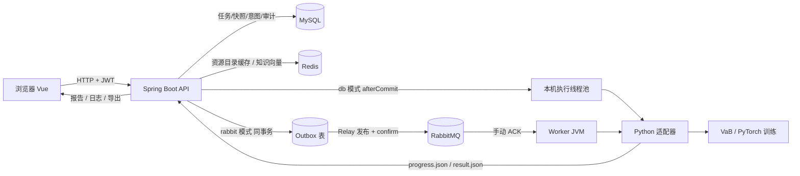

# 安全模型训练平台设计思路

本文回答三个问题：平台为什么存在，一次实验在系统里怎样流动，关键技术为什么放在当前的位置。具体的接口、SQL、文件和异常分支见 [实现指南](project-implementation-guide.md)；按场景阅读请直接看 [业务流程详解](project-business-flows.md)。

## 1. 项目定位

这是一个面向深度神经网络后门防御实验的单机平台。当前真正开放的执行入口是训练前 **LDD 数据清洗**：

```text
用户选择数据集、LDD 算法和参数
        ↓
创建一条可检查的任务
        ↓
确认启动，系统分配本轮 runId / attempt
        ↓
Java 调度 Python，Python 调用 VaB 训练
        ↓
Python 写进度和结构化结果
        ↓
Java 校验结果并落库
        ↓
页面查看状态、日志、报告，按需导出清洗子集
```

平台不是“点一下按钮就同步跑完训练”的脚本包装。它把长任务拆成可持久化、可恢复、可追踪的实验对象。用户关闭页面、Java 重启、消息重复投递，系统仍要回答四个问题：

| 问题 | 持久化载体 |
| --- | --- |
| 这条实验现在是什么状态？ | `sys_pre_defense` 任务行 |
| 这一轮到底用什么跑？ | `execution_snapshot` 执行快照 |
| 后台是否已经接手？ | `sys_task_dispatch_intent` 派发意图 |
| 某个筛选子集能否下载？ | 独立导出记录与 ZIP 文件 |

## 2. 设计目标与边界

**目标**

- 让实验者用页面完成“选资源、建任务、启动、看结果、导出”的闭环。
- 让 Java 管状态、权限、调度和资源，让 Python 管模型与训练依赖。
- 对重复点击、进程晚到、服务重启、MQ 重投递给出确定的收敛规则。
- 让每次运行都能回看到输入、参数、环境与产物。

**当前边界**

- 可执行算法限定为已启用、训练前、`vab://pre-defense/ldd`。
- LDD 可消费 CIFAR-10、CIFAR-100、GTSRB；Tiny ImageNet 可登记和校验目录，但当前 VaB LDD 不消费。
- 默认单机单 GPU 槽位。`db` 模式不依赖 MQ；`rabbit` 模式在同一台机器上使用真实 RabbitMQ。
- 训练进程以本机子进程运行，不是容器编排或跨机调度。
- Redis 是加速层，不是任务事实来源；Redis 故障时读请求回源 MySQL。

## 3. 总体架构



前端只和 Java API 通信。Java 和 Python 不通过 HTTP 互相调用，而是通过**本轮目录中的 JSON 文件和进程退出状态**交接。这样训练进程可以使用独立的 Python 环境，Java 也能在进程退出后重新读取和校验结果。

## 4. 领域对象与状态

### 4.1 三个身份

| 身份 | 生命周期 | 用途 |
| --- | --- | --- |
| `taskId` | 一条实验任务 | 用户操作、权限、报告、导出都围绕它 |
| `runId` | 一次启动/重试 | 区分同一任务的不同执行轮次 |
| `attempt` | 第几次运行 | 与 `runId` 一起定位本轮目录、快照和结果 |

同一个任务失败后重试，`taskId` 不变，`runId` 和 `attempt` 会更新。旧轮的 Python 进程即使晚写结果，也不能覆盖新一轮。

### 4.2 任务状态

```text
pending ──启动──> running ──成功──> success
   │                 ├──失败──> failed
   │                 └──取消──> canceled
   └──启动预检失败：仍为 pending，可修正后重试

failed ──重试──> running（新 runId / attempt）
```

`running` 只表示启动命令已经领取，**不保证 Python 已经创建**。判断“后台是否接手”要看派发意图和 attempt 目录，不能只看任务状态。

### 4.3 五张核心表

| 表 | 回答的问题 | 关键字段 |
| --- | --- | --- |
| `sys_pre_defense` | 任务当前怎样 | `status`、`current_run_id`、`current_attempt`、`progress` |
| `sys_pre_defense.execution_snapshot` | 本轮用什么跑 | 请求 JSON、资源指纹、配额、租约 |
| `sys_task_dispatch_intent` | 后台是否接手 | `pending/submitting/submitted/abandoned` |
| `sys_dispatch_outbox` | 消息是否要发/已发 | `message_id`、发布状态、claim token |
| `sys_dispatch_consumption` | Worker 是否消费过 | `message_id`、处理状态、claim token |

前两行回答任务事实，后三行回答派发事实。两套事实通过 `taskId + runId + attempt + messageId` 对齐，不能互相替代。

## 5. 一次正常实验的设计主线

### 5.1 创建和启动分开

创建 `POST /api/pre-defense` 只做资源解析、参数校验和 `pending` 建档，不启动进程。用户核对快照后再发 `POST /api/pre-defense/start/{taskId}`。这样：

- 创建失败不会留下半个运行；
- 用户可以在真正消耗 GPU 前检查参数；
- 启动需要额外确认，避免误操作；
- 两个请求可以使用不同的幂等键。

### 5.2 事务内写事实，事务后做副作用

启动事务内完成：

1. `SELECT ... FOR UPDATE` 锁任务行，校验归属和 `pending`；
2. 分配 `runId`、`attempt`；
3. 生成执行快照和请求指纹；
4. `claimForExecution` 条件更新为 `running`；
5. 写派发意图；`rabbit` 模式同时写 Outbox；
6. `db` 模式在本轮取得 GPU 租约。

事务提交后才把任务交给线程池或 RabbitMQ。理由是不能在数据库事务未提交时启动 Python：一旦事务回滚，进程已经在跑，系统无法收回。

### 5.3 两种派发模式共享同一业务模型

| 维度 | `db` 模式（默认） | `rabbit` 模式 |
| --- | --- | --- |
| 谁执行 | API JVM 的 `taskAsync` 线程池 | 独立 Worker JVM |
| 派发通道 | `afterCommit` 直接调用 | Outbox → Relay → RabbitMQ → Worker |
| GPU 租约何时取得 | 启动事务内 | Worker 消费并领取意图时 |
| 适合 | 本地开发、单进程演示 | 单机双进程、验证消息可靠性 |
| 消息重复 | 无 Broker 重投，但有 HTTP/线程重发 | Relay 重发和消费重投都可能发生 |

两种模式共用 `DefenseTaskRequest`、任务状态、Python 文件协议、报告和导出。切换模式只改“谁在什么时机调用执行器”，不另写一套训练逻辑。

### 5.4 运行身份贯穿所有写入

进度、结果、失败和取消的 SQL 都带：

```sql
WHERE task_id = ?
  AND current_run_id = ?
  AND status = 'running'
```

如果数据库已经切到 `r2`，`r1` 的迟到结果影响 0 行。业务层还会校验 `result.json` 里的 `run_id` 和 `attempt`。文件身份与数据库身份必须同时匹配。

### 5.5 GPU 租约与进程证据

单机只有一个 GPU 执行槽位。任务领取时取得带 fencing token 的租约；执行器结束后先确认进程树已经退出，再释放槽位。无法确认进程是否存活时，宁可隔离槽位，也不允许下一个任务贸然启动。

### 5.6 配置只有一个事实源

独立“超参模板”页面已经移除。算法的默认超参数维护在算法详情页的**参数配置中心**，写入 `sys_algorithm.default_config`。创建任务时：

```text
算法默认配置
  + 历史模板配置（仅兼容旧任务）
  + 本次自定义参数
  = 最终参数
```

新任务不再选择模板，`hyperId` 固定为 `null`。后端仍保留 `sys_hyper` 的读取路径，是为了历史任务和旧报告可追溯，不是新任务的配置来源。

## 6. 缓存与消息队列的位置

### 6.1 Redis 缓存

缓存只用于**读多写少、允许短暂旧值**的资源目录：

- 数据集列表、算法列表；
- 单条数据集、单条算法；
- TTL 5 分钟；
- 资源修改事务提交后删除缓存并递增 generation；
- 读请求未命中时回源 MySQL；Redis 异常直接降级，不阻塞业务；
- 启动、预览、确认等执行契约重新读 MySQL 权威行，不使用缓存。

这里最重要的设计不是“加缓存”，而是**缓存不能成为任务事实**。任务状态、参数、权限和租约永远以 MySQL 为准。

### 6.2 RabbitMQ

`rabbit` 模式使用真实 Broker，不是内存假队列。单机部署时 API、RabbitMQ、Worker 可以都在同一台机器：

```text
API JVM ──写 Outbox──> MySQL
   │
   └─ Relay ──publish/confirm──> RabbitMQ(localhost)
                                      │
                                  Worker JVM
                                      │
                                  Python/VaB
```

关键机制：

- **Outbox**：任务状态、派发意图和待发消息同一事务落库，避免“数据库成功、消息没发”。
- **Publisher Confirm + mandatory return**：Relay 等到 Broker 确认；不可路由消息会被识别。
- **手动 ACK**：Worker 只有在确认任务终态、消费账本终态或明确转移到重试/死信后才 ACK。
- **消费账本**：同一 `messageId` 插入 `processing` 行，重复投递不会启动第二个 Python。
- **TTL 重试队列**：5s / 30s / 120s 延迟后回到主队列，超过上限进 DLQ。
- **数据库仍是事实源**：消息只是“去执行”的通知，任务是否成功以 MySQL 和 `result.json` 为准。

因此，单机环境完全可以使用消息队列通信；当前实现已经支持，只是默认没有开启。

## 7. 技术栈分工

| 技术 | 在业务中的具体职责 | 不能替代什么 |
| --- | --- | --- |
| Vue 3 / Element Plus | 表单、任务详情、轮询、错误提示 | 不能替代服务端参数和权限校验 |
| Axios / JWT | 请求封装、身份传递 | JWT 只证明身份，不证明资源归属 |
| Spring Boot MVC | HTTP 入口、DTO 绑定、事务边界 | 不把长训练放在 HTTP 线程 |
| MySQL / MyBatis-Plus | 任务、快照、意图、租约、审计的持久化 | 不用缓存替代任务状态 |
| Redis | 资源目录缓存、知识向量索引 | 不存唯一事实，故障可降级 |
| RabbitMQ | `rabbit` 模式的派发通道 | 不保证训练恰好执行一次，靠账本收敛 |
| 线程池 | `db` 模式的本地异步执行 | 不跨 JVM，不提供 Broker 级持久化 |
| Python / PyTorch / VaB | 训练与数据清洗 | 不直接改任务状态 |
| JSON 文件协议 | Java 与 Python 的跨语言契约 | 不用 stdout 当结构化结果 |

## 8. 设计取舍

| 选择 | 好处 | 代价 |
| --- | --- | --- |
| 创建与启动分离 | 可检查、可追溯、降低误启动 | 多一次用户确认和接口 |
| 数据库行锁 + 条件更新 | 多请求、多进程下仍只有一个赢家 | SQL 和状态机更复杂 |
| 文件协议而非 RPC | Python 环境独立、结果可留档 | 要管理目录、超时和结果缺失 |
| Outbox + 消费账本 | 消息可重投而不重复启动 | 多两张表和恢复逻辑 |
| Redis 只做缓存 | 故障不影响任务正确性 | 列表可能短暂旧值 |
| 单 GPU 租约 | 避免两个训练争同一张卡 | 吞吐受单槽限制 |
| 参数配置中心 | 一个算法一份默认配置，避免模板漂移 | 旧模板需要兼容读取 |

继续阅读：

- [实现指南：沿着代码走完整链路](project-implementation-guide.md)
- [业务流程详解：正常、失败、取消、重试、MQ、导出](project-business-flows.md)
- [面试讲解与白板](project-introduction-and-interview-guide.md)
