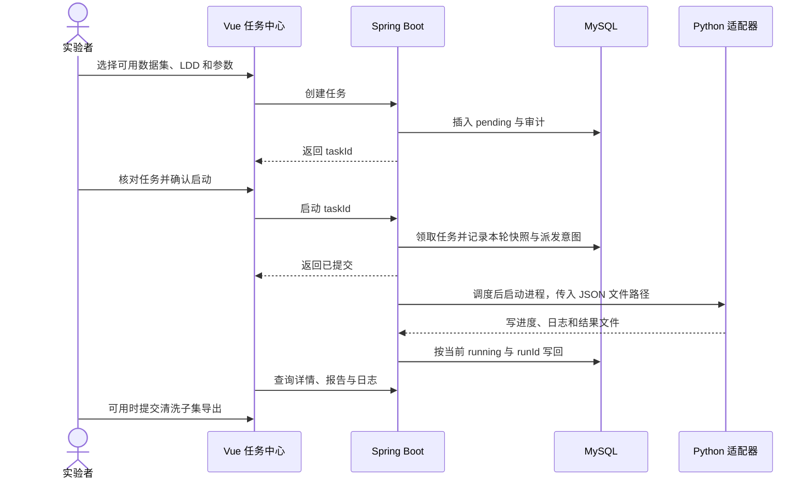

# 安全模型训练平台设计思路

## 用户为什么需要这个平台

实验者要对可疑训练数据执行 LDD 清洗，随后查看结果并复用筛选后的样本。直接用 Python 脚本也能算，但操作者还需要决定用哪个数据集、记录最终参数、确认哪一轮运行生成了结果，以及处理失败和资源占用。平台把这些步骤做成任务流程。

平台按训练前、训练中、训练后组织展示。可执行入口限定为已启用的训练前 `vab://pre-defense/ldd`。一次真实运行可产生筛选索引和报告。满足数据与产物条件时，用户能另行提交 CIFAR-10 清洗子集 ZIP 导出。

## 一次实验如何走完

`pending` 表示已建档。`running` 表示启动命令已领取，可能仍在等派发。`success`、`failed` 和 `canceled` 表示本轮业务结果。每个运行使用 `runId` 区分身份，用 `attempt` 区分次数。用户重试失败任务时保留 `taskId`，获得新的运行身份。

有四份记录可以分别回答四个问题。任务行回答“实验现在怎样”，执行快照回答“这次打算用什么跑”，派发意图回答“后台是否接手”，导出行回答“某个比例的 ZIP 是否可下载”。进程结束后，报告从任务结果和产物信息拼装。用 `taskId` 找任务，用 `runId` 和 `attempt` 找运行，用 `exportId` 找导出。

## 面试值得讲的三个设计

| 故事 | 真实难点 | 展示证据 | 可发散的基础 |
| --- | --- | --- | --- |
| 把 LDD 变成可操作的实验任务 | 浏览器、Java 和 Python 使用不同的数据与进程边界 | 一个启动请求、一对 request/result JSON，以及 `validateResult` | HTTP、序列化、进程与线程、子进程退出码 |
| 长任务的状态与资源一致性 | 用户可能重发、取消，部署进程可能退出，旧结果还可能迟到 | `FOR UPDATE`、`claimForExecution`、`runId` 谓词、派发意图、退出证据 | 事务、锁、幂等、线程池拒绝、恢复和资源租约 |
| 让实验结果能查、能用 | 运行过程、结构化结果和 ZIP 的生成时机不同 | 执行快照、日志 offset、报告与 `exportId` | API 状态模型、产物生命周期、一致性和授权 |

讲第一段用一张顺序图。讲第二段用 `42/r1/1` 和 `42/r2/2` 推演。讲第三段拿出一条成功结果，却没有可用 ZIP 的情况，解释报告条件和导出重建。每段挑自己做过的一处改动以及一项验证。可选 RabbitMQ、Redis 和助手放在主线之后。

## 技术放在什么位置

| 技术 | 这条任务中负责什么 | 在哪看 |
| --- | --- | --- |
| Vue / Element Plus | 绑定表单、调用接口、展示运行结果 | [TaskCenterView.vue](../migration-frontend/src/views/TaskCenterView.vue) |
| Axios / Pinia / Vue Router | 请求封装、前端会话状态和页面导航 | [前端入口](../migration-frontend/src) |
| Spring MVC / Jackson | 接收 HTTP，把请求体反序列化成 Java 对象，生成进程请求文件 | [控制器](../migration-backend/src/main/java/com/securitymodel/interfaces/web/PreDefenseTaskController.java) |
| Spring Security / JWT | 识别当前用户。业务层随后验证任务归属和资源权限 | [SecurityConfig](../migration-backend/src/main/java/com/securitymodel/infrastructure/security/SecurityConfig.java) |
| MyBatis-Plus / MySQL | 读写任务并执行带状态谓词的 SQL，存储快照、租约、意图等记录 | [PreDefenseTaskMapper](../migration-backend/src/main/java/com/securitymodel/infrastructure/persistence/mapper/PreDefenseTaskMapper.java) |
| Redis | 加速资源目录查询。知识模块可用 Redis 8 向量功能辅助排序 | [资源查询](../migration-backend/src/main/java/com/securitymodel/application/resource/ResourceQueryService.java) |
| RabbitMQ | 可选派发通道，通知独立 Worker 领取运行任务 | [派发契约](sdd/21-r4-outbox-rabbitmq-design.md) |
| Python / PyTorch | Python 适配器负责接入外部 VaB，训练实现使用 PyTorch | [algorithm_entry.py](../algorithm-runtime/vab/algorithm_entry.py) |

## 设计为什么这样分

| 业务问题 | 代码里的解法 | 边界 |
| --- | --- | --- |
| 页面等不起长训练 | 先提交命令，事务提交后异步执行，再查询状态 | 接口成功时任务已受理 |
| 进程在提交后、启动前退出 | 在任务状态变更的事务里保存派发意图 | 恢复流程按意图状态决定补派发或收敛 |
| 双击、网络重发、旧运行晚到 | 请求幂等记录、任务条件更新、按轮结果校验 | 三者分别处理请求、状态、运行身份 |
| 多任务共用单机 GPU | 单槽 GPU 租约、续约、fencing 和进程退出确认 | 进程存活不确定时隔离槽位 |
| 配置改了，结果难追溯 | 执行请求、运行环境、输入指纹和产物按 attempt 保存 | 环境指纹帮助定位差异。跨硬件完全复现仍需实验证据 |
| 消息和数据库分别成功 | Rabbit 模式把 Outbox 跟任务事务一起写，Relay 之后发布 | 允许重复投递，Worker 按消息账本与任务身份收敛 |
| 助手可以提出写操作 | 服务器生成预览与一次性确认。确认后调用同一业务服务 | 用户权限、任务状态与参数规则始终由后端执行 |

`db` 模式默认由一个 API 进程完成派发和执行。`rabbit` 模式中 API 写 Outbox，Relay 发布，Worker 领取并启动 Python。两种模式共享任务模型、报告和文件协议。学习时先画通 `db` 路线，再标出 Rabbit 模式把哪些职责挪到了 Worker。

继续看 [从 HTTP 到 SQL 和进程的实现指南](project-implementation-guide.md)。
