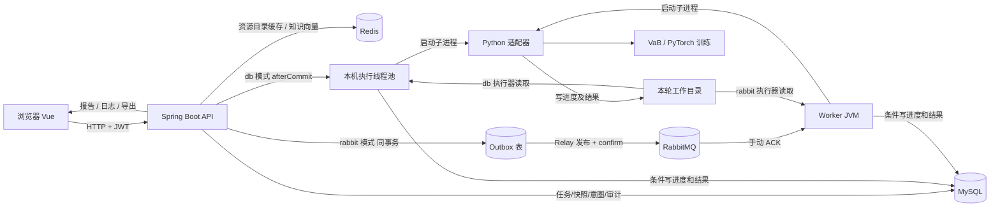

# 安全模型训练平台设计思路

本文回答三个问题：平台为什么存在，一次实验在系统里怎样流动，关键技术为什么放在当前的位置。具体的接口、SQL、文件和异常分支见 [实现指南](project-implementation-guide.md)；按场景阅读请直接看 [业务流程详解](project-business-flows.md)。

## 0. 先看懂设计解决了什么

实验者原本需要在 Python 环境里准备数据、修改参数、运行脚本，再从输出目录找结果。平台负责把这些动作组织成可在网页上操作和追踪的任务。用 `42 / r1 / 1` 举例：`42` 是实验配置的身份，`r1` 是第一次启动时生成的运行身份，`1` 是这条任务的第一次尝试。运行成功后选择一个有索引的保留比例，系统再创建独立的导出记录。

| 用户遇到的问题 | 设计决定 | 学习时验证什么 |
| --- | --- | --- |
| 配置还要检查，训练需要等待 | 创建保存 `pending`，确认后领取一次运行 | 在 Network 找两个 POST，在库里找到只在启动时出现的 `current_run_id` |
| 刷新网页后仍要知道任务去了哪里 | 当前状态、每轮快照与派发意图写入 MySQL | `running` 表示任务已领取。继续查看意图和进程证据才能判断 Python 有没有启动 |
| Java 管业务，算法依赖 PyTorch | `DefenseTaskExecutor` 定义 Java 侧执行入口，Python 进程通过文件协议接收输入并产出结果 | 找出绝对路径通过哪个参数传递、JSON 由哪个进程读、数据库由谁更新 |
| 前一轮晚到会污染后一轮 | 文件按 attempt 分开，写库再校验 `runId` 和状态 | 把 SQL 中的 `current_run_id` 代入 `r1` 和 `r2`，算出受影响行数 |
| ZIP 存储和任务执行的故障可以独立发生 | 导出有自己的 ID、状态和文件有效性检查 | 任务 `success` 时找出四种导出状态，以及已成功记录对应文件失效的处理 |

架构图读三次。第一遍只走默认 `db` 路线，找到请求线程交给工作线程的位置。第二遍给每个箭头标记数据载体，分别是 HTTP、数据库行、命令行参数和文件。第三遍再看 RabbitMQ 替换了哪一段派发，以及助手在哪里复用现有接口后面的业务服务。

## 1. 项目定位

这是一个面向深度神经网络后门防御实验的单机平台。当前真正开放的执行入口是训练前 **LDD 数据清洗**：

```text
用户选择数据集、LDD 算法和参数
        ↓
创建一条可检查的任务
        ↓
确认启动，系统分配本轮 runId / attempt
        ↓
Java 调度 Python，Python 调用 VaB 训练
        ↓
Python 写进度和结构化结果
        ↓
Java 校验结果并落库
        ↓
页面查看状态、日志、报告，按需导出清洗子集
```

平台不是“点一下按钮就同步跑完训练”的脚本包装。它把长任务拆成可持久化、可恢复、可追踪的实验对象。用户关闭页面、Java 重启、消息重复投递，系统仍要回答四个问题：

| 问题 | 持久化载体 |
| --- | --- |
| 这条实验现在是什么状态？ | `sys_pre_defense` 任务行 |
| 这一轮到底用什么跑？ | `execution_snapshot` 执行快照 |
| 后台是否已经接手？ | `sys_task_dispatch_intent` 派发意图 |
| 某个筛选子集能否下载？ | 独立导出记录与 ZIP 文件 |

## 2. 设计目标与边界

**目标**

- 让实验者用页面完成“选资源、建任务、启动、看结果、导出”的闭环。
- 让 Java 管状态、权限、调度和资源，让 Python 管模型与训练依赖。
- 对重复点击、进程晚到、服务重启、MQ 重投递给出确定的收敛规则。
- 让每次运行都能回看到输入、参数、环境与产物。

**当前边界**

- 可执行算法限定为已启用、训练前、`vab://pre-defense/ldd`。
- LDD 可消费 CIFAR-10、CIFAR-100、GTSRB；Tiny ImageNet 可登记和校验目录，但当前 VaB LDD 不消费。
- 默认单机单 GPU 槽位。`db` 模式不依赖 MQ；`rabbit` 模式在同一台机器上使用真实 RabbitMQ。
- 训练进程以本机子进程运行，不是容器编排或跨机调度。
- Redis 是加速层，不是任务事实来源；Redis 故障时读请求回源 MySQL。

**设计非目标**

- 不把训练中、训练后算法伪装成可执行能力；没有执行器和参数契约的阶段只做目录展示。
- 不把统计页做成“什么指标都有”的看板；没有采集源的 ASR、GPU 利用率和样本保留率不填估算值。
- 不用内存队列模拟 RabbitMQ。`db` 和 `rabbit` 是两条独立的真实派发链路，不互相冒充。
- 不宣称 RabbitMQ 能保证训练“恰好执行一次”；系统采用至少一次投递 + 身份幂等收敛。
- 不把单机双进程演练表述成生产多机部署；跨主机调度、长期 DB 故障压力和多实例容量仍未验收。

## 3. 总体架构



前端只和 Java API 通信。Java 和 Python 不通过 HTTP 互相调用，而是通过**本轮目录中的 JSON 文件和进程退出状态**交接。这样训练进程可以使用独立的 Python 环境，Java 也能在进程退出后重新读取和校验结果。

## 4. 领域对象与状态

### 4.1 三个身份

| 身份 | 生命周期 | 用途 |
| --- | --- | --- |
| `taskId` | 一条实验任务 | 用户操作、权限、报告、导出都围绕它 |
| `runId` | 一次启动/重试 | 区分同一任务的不同执行轮次 |
| `attempt` | 第几次运行 | 与 `runId` 一起定位本轮目录、快照和结果 |

同一个任务失败后重试，`taskId` 不变，`runId` 和 `attempt` 会更新。旧轮的 Python 进程即使晚写结果，也不能覆盖新一轮。

### 4.2 任务状态

```text
pending ──启动──> running ──成功──> success
   │                 ├──失败──> failed
   │                 └──取消──> canceled
   └──启动预检失败：仍为 pending，可修正后重试

failed ──重试──> running（新 runId / attempt）
```

`running` 只表示启动命令已经领取，**不保证 Python 已经创建**。判断“后台是否接手”要看派发意图和 attempt 目录，不能只看任务状态。

### 4.3 核心持久化记录

| 记录位置 | 回答的问题 | 关键字段 |
| --- | --- | --- |
| `sys_pre_defense` | 任务当前怎样 | `status`、`current_run_id`、`current_attempt`、`progress` |
| `sys_pre_defense.execution_snapshot` | 本轮用什么跑 | 请求 JSON、资源指纹、配额、租约 |
| `sys_task_dispatch_intent` | 后台是否接手 | `pending/submitting/submitted/abandoned` |
| `sys_dispatch_outbox` | 消息是否要发/已发 | `message_id`、发布状态、claim token |
| `sys_dispatch_consumption` | Worker 是否消费过 | `message_id`、处理状态、claim token |

前两行位于同一张任务表，后三行用于派发追踪。默认 `db` 模式用任务与派发意图对齐轮次，`rabbit` 模式再用 `messageId` 对齐发布和消费。

## 5. 一次正常实验的设计主线

### 5.1 创建和启动分开

创建 `POST /api/pre-defense` 做资源解析、参数校验和 `pending` 建档。用户核对任务后再发 `POST /api/pre-defense/start/{taskId}`。执行快照在启动事务内建立。这样：

- 创建失败不会留下半个运行；
- 用户可以在真正消耗 GPU 前检查参数；
- 启动需要额外确认，避免误操作；
- 两个请求可以使用不同的幂等键。

### 5.2 事务内写事实，事务后做副作用

启动事务内完成：

1. `SELECT ... FOR UPDATE` 锁任务行，校验归属和 `pending`；
2. 分配 `runId`、`attempt`；
3. 生成执行快照和请求指纹；
4. `claimForExecution` 条件更新为 `running`；
5. 写派发意图；`rabbit` 模式同时写 Outbox；
6. `db` 模式在本轮取得 GPU 租约。

事务提交后才把任务交给线程池或 RabbitMQ。理由是不能在数据库事务未提交时启动 Python：一旦事务回滚，进程已经在跑，系统无法收回。

### 5.3 两种派发模式共享同一业务模型

| 维度 | `db` 模式（默认） | `rabbit` 模式 |
| --- | --- | --- |
| 谁执行 | API JVM 的 `taskAsync` 线程池 | 独立 Worker JVM |
| 派发通道 | `afterCommit` 直接调用 | Outbox → Relay → RabbitMQ → Worker |
| GPU 租约何时取得 | 启动事务内 | Worker 消费并领取意图时 |
| 适合 | 本地开发、单进程演示 | 单机双进程、验证消息可靠性 |
| 消息重复 | 无 Broker 重投，但有 HTTP/线程重发 | Relay 重发和消费重投都可能发生 |

两种模式共用 `DefenseTaskRequest`、任务状态、Python 文件协议、报告和导出。切换模式只改“谁在什么时机调用执行器”，不另写一套训练逻辑。

### 5.4 运行身份贯穿所有写入

进度、结果、失败和取消的 SQL 都带：

```sql
WHERE task_id = ?
  AND current_run_id = ?
  AND status = 'running'
```

如果数据库已经切到 `r2`，`r1` 的迟到结果影响 0 行。业务层还会校验 `result.json` 里的 `run_id` 和 `attempt`。文件身份与数据库身份必须同时匹配。

### 5.5 GPU 租约与进程证据

单机只有一个 GPU 执行槽位。任务领取时取得带 fencing token 的租约；执行器结束后先确认进程树已经退出，再释放槽位。无法确认进程是否存活时，宁可隔离槽位，也不允许下一个任务贸然启动。

### 5.6 配置只有一个事实源

独立“超参模板”页面已经移除。算法的默认超参数维护在算法详情页的**参数配置中心**，写入 `sys_algorithm.default_config`。创建任务时：

```text
算法默认配置
  + 历史模板配置（仅兼容旧任务）
  + 本次自定义参数
  = 最终参数
```

新任务不再选择模板，`hyperId` 固定为 `null`。后端仍保留 `sys_hyper` 的读取路径，是为了历史任务和旧报告可追溯，不是新任务的配置来源。

## 6. 缓存与消息队列的位置

### 6.1 Redis 缓存

缓存只用于**读多写少、允许短暂旧值**的资源目录：

- 数据集列表、算法列表；
- 单条数据集、单条算法；
- TTL 5 分钟；
- 资源修改事务提交后删除缓存并递增 generation；
- 读请求未命中时回源 MySQL；Redis 异常直接降级，不阻塞业务；
- 启动、预览、确认等执行契约重新读 MySQL 权威行，不使用缓存。

这里最重要的设计不是“加缓存”，而是**缓存不能成为任务事实**。任务状态、参数、权限和租约永远以 MySQL 为准。

### 6.2 RabbitMQ

`rabbit` 模式使用真实 Broker，不是内存假队列。单机部署时 API、RabbitMQ、Worker 可以都在同一台机器：

```text
API JVM ──写 Outbox──> MySQL
   │
   └─ Relay ──publish/confirm──> RabbitMQ(localhost)
                                      │
                                  Worker JVM
                                      │
                                  Python/VaB
```

关键机制：

- **Outbox**：任务状态、派发意图和待发消息同一事务落库，避免“数据库成功、消息没发”。
- **Publisher Confirm + mandatory return**：Relay 等到 Broker 确认；不可路由消息会被识别。
- **手动 ACK**：Worker 只有在确认任务终态、消费账本终态或明确转移到重试/死信后才 ACK。
- **消费账本**：同一 `messageId` 插入 `processing` 行，重复投递不会启动第二个 Python。
- **TTL 重试队列**：5s / 30s / 120s 延迟后回到主队列，超过上限进 DLQ。
- **数据库仍是事实源**：消息只是“去执行”的通知，任务是否成功以 MySQL 和 `result.json` 为准。

因此，单机环境完全可以使用消息队列通信；当前实现已经支持，只是默认没有开启。

## 7. 技术栈分工

| 初学者遇到的术语 | 在项目里可以怎样理解 | 对应代码 |
| --- | --- | --- |
| Controller / Service / Mapper | 把一次实验申请想成柜台收表、业务人员审批和账本登记。HTTP 地址和输入属于 Controller，审批规则属于 Service，SQL 属于 Mapper | `PreDefenseTaskController.create` → `PreDefenseTaskCommandService.create` → `PreDefenseTaskMapper.insert` |
| 依赖注入和代理 | Spring 把已创建的 Service 注入 Controller。调用事务 Service 时，代理负责开始事务与提交或回滚。调度协调器经异步代理调用执行器时，切换到线程池 | `@Transactional` 的命令入口、`@Async("taskAsync")` 的 `runPreDefense` |
| 线程池和进程 | 工作线程是 JVM 里负责处理任务的工作人员，Python 是它启动的另一个程序。工作线程可以一直等子进程，因此需要限制工作线程和等待队列 | `TaskExecutorConfig`、`PythonLddTaskExecutor` |
| 派发意图与 Outbox | 派发意图记录这次运行的交接阶段。Outbox 是 Rabbit 模式下记录待发消息的表。消息发布后还需要消费账本记住处理结果 | `TaskDispatchIntentService`、`TaskOutboxRelay`、`TaskDispatchConsumptionService` |
| Tool / RAG / 人工确认 | Tool 是带输入约束和业务实现的能力，RAG 先检索授权知识作为回答依据，确认接口负责核验后执行写入 | `AssistantToolRegistry`、`AssistantPreviewService`、`AssistantConfirmationService` |

沿一个主题扩展开发基础，例如从「连续点两次启动」复习 Spring 事务代理、InnoDB 行锁、条件更新和 HTTP 幂等。每个概念都要能指出它解决的那个并发窗口。分层练习见 [技术栈学习地图](learning/technology-map.md)。

| 技术 | 在业务中的具体职责 | 不能替代什么 |
| --- | --- | --- |
| Vue 3 / Element Plus | 表单、任务详情、轮询、错误提示 | 不能替代服务端参数和权限校验 |
| Axios / JWT | 请求封装、身份传递 | JWT 只证明身份，不证明资源归属 |
| Spring Boot MVC | HTTP 入口、DTO 绑定、事务边界 | 不把长训练放在 HTTP 线程 |
| MySQL / MyBatis-Plus | 任务、快照、意图、租约、审计的持久化 | 不用缓存替代任务状态 |
| Redis | 资源目录缓存、知识向量索引 | 不存唯一事实，故障可降级 |
| RabbitMQ | `rabbit` 模式的派发通道 | 不保证训练恰好执行一次，靠账本收敛 |
| 线程池 | `db` 模式的本地异步执行 | 不跨 JVM，不提供 Broker 级持久化 |
| Python / PyTorch / VaB | 训练与数据清洗 | 不直接改任务状态 |
| JSON 文件协议 | Java 与 Python 的跨语言契约 | 不用 stdout 当结构化结果 |

## 8. 设计取舍

| 选择 | 好处 | 代价 |
| --- | --- | --- |
| 创建与启动分离 | 可检查、可追溯、降低误启动 | 多一次用户确认和接口 |
| 数据库行锁 + 条件更新 | 多请求、多进程下仍只有一个赢家 | SQL 和状态机更复杂 |
| 文件协议而非 RPC | Python 环境独立、结果可留档 | 要管理目录、超时和结果缺失 |
| Outbox + 消费账本 | 消息可重投而不重复启动 | 多两张表和恢复逻辑 |
| Redis 只做缓存 | 故障不影响任务正确性 | 列表可能短暂旧值 |
| 单 GPU 租约 | 避免两个训练争同一张卡 | 吞吐受单槽限制 |
| 参数配置中心 | 一个算法一份默认配置，避免模板漂移 | 旧模板需要兼容读取 |

## 9. 前端信息架构

### 9.1 页面职责

前端不是把所有后端字段平铺出来，而是按用户任务组织页面。每个页面只回答一个主要问题：

| 页面 | 路由 | 主要回答 | 数据来源 |
| --- | --- | --- | --- |
| 工作台 | `/dashboard` | 现在整体情况怎样、下一步去哪里 | `GET /api/dashboard/overview?days=7`、执行池状态 |
| 数据集资源 | `/datasets` | 有哪些数据、哪些已经核验、哪些能启用 | 数据集接口、验证结果 |
| 算法资源 | `/algorithms` | 有哪些防御算法、处于哪个阶段、参数默认值是什么 | 算法目录、参数配置中心 |
| 安全防御任务 | `/tasks` | 创建、启动、取消、重试、看报告和日志 | 任务接口、报告、日志、导出 |
| 运行监控 | `/runtime-monitor` | 本机资源够不够、后台是否接手、消息是否积压 | 执行池、GPU、算法目录、Outbox、Worker |
| 数据统计 | `/statistics` | 一段时间内任务质量和资源构成怎样 | 任务统计、工作台聚合 |
| 知识检索 | `/knowledge` | 项目知识能否被检索、引用来自哪里 | 知识索引与检索接口 |
| 实验助手 | `/assistant` | 能否用自然语言生成可确认的实验草案 | 助手会话、预览、确认记录 |
| 防御案例 | `/cases` | 防御方法和案例怎样对照 | 案例与知识材料 |
| 账号管理 | `/accounts` | 用户和角色怎样维护 | 管理员账号接口 |

页面职责明确后，同一个指标只在最合适的位置展示。任务页不再放执行池和接入范围，运行监控也不再重复完整任务列表；统计页只展示分析结果和原始明细，不重复工作台的操作入口。

### 9.2 数据集页的“语义压缩”

后端类型仍然是 `image_classification`、`text_classification`、`tabular`，因为这是资源的领域属性。页面只做展示映射：

```text
image_classification → image
text_classification  → text
tabular              → table
```

这样做解决的是列表可读性，不是修改数据模型。类型列变短后，训练样本、类别数、状态和操作才有足够宽度。

状态列被压缩成两个用户能快速判断的结论：

```text
parse_status=success 且 sampleCount/classCount 都是整数 → 已核验
其它情况（pending/failed/仅路径可用/统计缺失）          → 待验证
```

失败原因仍保留在 tooltip 的 `parseMessage` 中。停用状态不混入验证状态，而是在名称旁显示“已停用”标签。于是顶部摘要可以稳定表达三个维度：已核验、待验证、已启用。

这里有一个重要边界：**已核验表示文件内容和统计已验证，不等于当前算法可执行。** Tiny ImageNet 可以因目录结构和统计字段完整而显示“已核验”，但创建 LDD 任务时仍会因缺少运行支持被拒绝。验证状态和执行能力是两个维度。

### 9.3 任务页与运行监控的边界

任务页面向“我要完成一条实验”，运行监控面向“系统现在能不能接单、任务有没有被后台接手”。因此：

- 任务页保留任务统计、筛选、列表、详情抽屉、报告、日志、操作记录和导出。
- 执行池状态、运行配额、GPU 租约、平台接入和消息派发移入运行监控。
- 运行监控按三类展示：执行资源、平台接入、消息派发。
- 本机硬件指标只代表 API 进程所在机器；Outbox、消费者和 GPU 租约是分布式调度事实，不能混读。

这种拆分减少了两页重复，也让“业务操作失败”和“调度资源不足”能被快速区分。

### 9.4 工作台与数据统计的边界

两个页面都使用真实聚合，但回答的问题不同：

| 页面 | 定位 | 展示深度 |
| --- | --- | --- |
| 工作台 | 行动导向 | 任务/资源 KPI、固定 7 日趋势、防御阶段、最近任务、执行池、快捷入口 |
| 数据统计 | 分析导向 | 4 个 KPI、5 状态环图、7/14/30 日堆叠趋势、完成质量、阶段构成、最近明细、统计口径 |

统计页不是工作台的复制，而是把“结果质量、状态结构和时间趋势”展开。它明确标注统计范围、采样时间和未采集指标，避免用户把演示数字当成实验结果。

### 9.5 图表实现取舍

当前统计页采用原生 CSS 绘制环图和堆叠柱：

- 状态环图使用 `conic-gradient`；
- 完成质量环使用 `conic-gradient`；
- 趋势图按每日状态动态分配柱段高度；
- tooltip 和统计口径仍由 Vue 组件承载。

好处是不引入额外图表库、构建体积小、页面风格一致，适合当前数据规模。代价是缺少缩放、图例交互、数据导出和大数据量降采样能力；当趋势窗口继续扩大或需要多指标联动时，应迁移到 ECharts 等图表层，而不是继续堆 CSS。

## 10. 可观测性设计

### 10.1 三层观测

运行监控把指标分为三层，避免把不同事实混成一个“健康度”：

| 层 | 指标 | 事实来源 | 能回答 |
| --- | --- | --- | --- |
| 本机遥测 | CPU、物理内存、JVM 堆、磁盘、JVM uptime | API 进程所在机器 | 这台机器是否吃紧 |
| 执行资源 | `taskAsync` 活跃/最大线程、队列、运行配额、GPU 租约 | JVM 线程池 + MySQL 租约 | 现在能不能再接一个任务 |
| 派发与消费 | mode/role、Outbox 各状态、Worker 归属、消费账本 | MySQL 调度账本 + 进程状态 | 消息是否发出去、后台是否接手 |

平台接入是第四类静态能力信息：从算法目录计算“可执行算法、训练前登记、仅目录展示”。它不是运行负载指标，放在“平台接入”区，避免和 CPU/线程池混在一起。

### 10.2 `dispatchReady` 不等于“MQ 已启用”

`dispatchReady=true` 表示当前派发模式已经完成恢复、可以接单。它可能是 `db/api` 的本地线程池，也可能是 `rabbit/worker` 的消费者。判断 RabbitMQ 是否真正参与任务，要看：

- `mode` 是否为 `rabbit`；
- `role` 是否为 `worker` 或 `all`；
- `workerConsumerExpected`、`workerConsumerStarted` 是否为真；
- Broker 的 AMQP/管理端口是否监听；
- `outboxAvailable` 与 Outbox 各状态是否可读。

当前默认运行值是 `db/api`，所以 Outbox 全为 0 是正常现象，不代表表坏了，也不代表消息队列在工作。

### 10.3 统计口径

数据统计页的指标按以下定义计算：

| 指标 | 口径 |
| --- | --- |
| 任务总数 | 当前账号可见的非 `demo` 任务；管理员可查看全部用户 |
| 任务成功率 | `successCount / totalCount` |
| 待处理任务 | `pendingCount + runningCount` |
| 报告就绪率 | 已有清洗结果的成功任务数 / 成功任务数 |
| 状态分布 | success、failed、pending、running、canceled 五类 |
| 趋势 | 按任务创建时间落在 7/14/30 日窗口 |
| 资源启用率 | 数据集启用率与算法启用率的算术平均 |
| 防御阶段构成 | 算法目录按 pre / during / post 计数 |

没有真实采集源时宁可显示“未采集”，也不把 0 当作健康值，或用常量模拟 ASR、GPU 利用率和样本保留率。统计页的“统计口径”卡片就是把这条约束显式写给用户。

## 11. 权限与部署边界

### 11.1 权限

- JWT 证明身份；资源和任务写操作还要校验 `owner_user_id`。
- 普通用户只能看到自己的任务聚合；管理员可查看全量聚合和调度观测。
- 资源登记、数据集验证、算法默认配置、账号管理是管理员操作。
- 实验助手的写操作必须经过预览、服务器确认令牌和权限/版本重校验，不能直接调用启动接口。
- 统计页的管理员范围标签来自后端 `scope`，不是前端猜测。

### 11.2 部署拓扑

```text
浏览器
  │ 静态页面 + /api 代理
  ▼
Spring Boot API
  ├─ MySQL：任务、快照、意图、租约、Outbox、消费账本、审计
  ├─ Redis：资源目录缓存、可选知识向量
  ├─ taskAsync：db 模式的本地执行线程池
  └─ RabbitMQ（可选）
        └─ Worker JVM：rabbit 模式消费与 Python 执行
```

单机也可以使用真实 RabbitMQ。`role=all` 在代码层允许一个 JVM 同时提供 API 和消费者，但仓库的 `Start-SecurityModelStack.ps1 -Role all` 实际会启动 API 与 Worker 两个 JVM；不能把脚本行为误写成“单 JVM 演示”。消息无论哪种拓扑都经过 Broker。

### 11.3 当前运行事实

截至 2026-11-25 的本地验收实例：

- `dispatch.mode=db`、`role=api`；
- `workerConsumerExpected=false`、`workerConsumerStarted=false`；
- RabbitMQ 程序目录存在，但 `5672/5673/15672` 没有监听；
- Outbox 各状态为 0，原因是 `db` 模式不写 Outbox。

这类数值会随环境和操作变化，文档只保留判定方法；当前值以运行时接口和采样时间为准。

## 12. 设计不变量

无论使用哪种派发模式，以下不变量不能破：

1. 创建只建档，启动才产生 `runId/attempt`。
2. 事务内先写任务事实，事务提交后才启动 Python 或发布消息。
3. MySQL 是任务、快照、权限和租约的事实源；Redis 与 RabbitMQ 都不是。
4. 所有结果、取消和重试写入都必须匹配当前 `taskId + runId + attempt + status`。
5. GPU 槽位只有在确认进程退出或确认未启动后才释放；不确定时隔离。
6. `rabbit` 模式的业务事实与 Outbox 必须同事务写入，Relay 只能发布已提交事实。
7. 消息允许重复，执行不允许重复；用意图、消费账本和运行身份收敛。

继续阅读：

- [实现指南：沿着代码走完整链路](project-implementation-guide.md)
- [业务流程详解：正常、失败、取消、重试、MQ、监控与统计](project-business-flows.md)
- [面试讲解与白板](project-introduction-and-interview-guide.md)
