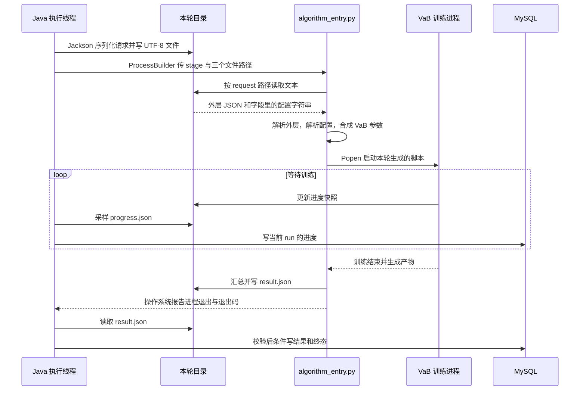
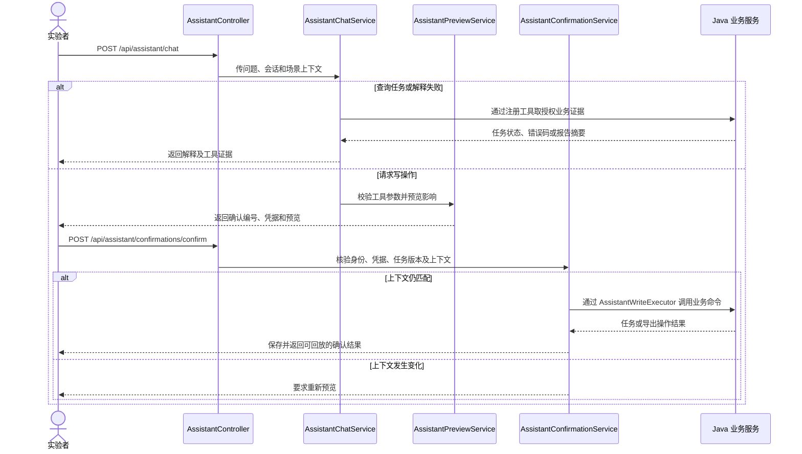

# 安全模型训练平台实现指南

本文沿着“前端创建任务 → 后端建档 → 确认启动 → 派发 → Python/VaB 执行 → 结果回写 → 报告/导出”逐段看代码。默认以 `db/api` 单进程模式讲解，再标出 `rabbit` 模式的差异。示例任务号沿用教学中的 `42`，真实 `runId` 由 UUID 生成。

配套阅读：[业务流程详解](project-business-flows.md) 用多个场景串起同一套链路；[设计思路](project-design-overview.md) 解释为什么这样分层。

## 1. 代码地图与启动顺序

带着 `42 / r1 / 1` 学。先打开页面和 API 文件，再进入 Java。每看到一个方法，把传入值、持久化位置和下一个调用者写下来。下面的顺序和[业务流程时序图](project-business-flows.md#一次-cifar-10-实验怎样完成)一致。

| 跟读点 | 打开文件，搜索方法 | 要回答的问题 |
| --- | --- | --- |
| 预览与建档 | [TaskCenterView.vue](../migration-frontend/src/views/TaskCenterView.vue) 搜 `loadParameters`、`submitCreate`，再读 [preDefense.js](../migration-frontend/src/api/preDefense.js) | ID 选自哪里，哪一步只预览，哪一步写任务？ |
| HTTP 与 DTO | [PreDefenseTaskController.java](../migration-backend/src/main/java/com/securitymodel/interfaces/web/PreDefenseTaskController.java) 搜 `previewParameters`、`create`、`start` | 两个 POST 传参分别走 `@RequestBody` 和 `@PathVariable`，框架如何找到对应方法？ |
| 业务事务 | [PreDefenseTaskCommandService.java](../migration-backend/src/main/java/com/securitymodel/application/task/PreDefenseTaskCommandService.java) 搜 `create`、`lockOwned`、`launchTask` | 哪些值来自表单，哪些由后端生成，哪些行必须同事务提交？ |
| 数据库边界 | [PreDefenseTaskMapper.java](../migration-backend/src/main/java/com/securitymodel/infrastructure/persistence/mapper/PreDefenseTaskMapper.java) 搜 `claimForExecution`、`finishForRun` | 启动和完成分别允许从什么状态进入？SQL 返回 0 行时发生了什么？ |
| 跨语言执行 | [PythonLddTaskExecutor.java](../migration-backend/src/main/java/com/securitymodel/infrastructure/executor/PythonLddTaskExecutor.java) 搜 `invoke`，跟进 [algorithm_entry.py](../algorithm-runtime/vab/algorithm_entry.py) 的 `main`、`run`、`build_config` | 参数文本在哪里写入、在哪里解析？Java 凭什么认领结果？ |
| 交付 | [PreDefenseReportController.java](../migration-backend/src/main/java/com/securitymodel/interfaces/web/PreDefenseReportController.java) 搜 `cleaned-dataset/exports`，跟到 [CleanSubsetExportService.java](../migration-backend/src/main/java/com/securitymodel/application/export/CleanSubsetExportService.java) 的 `submit` | 为什么报告可读、导出成功和 ZIP 可下载要分别判断？ |

| 层 | 目录 | 主要职责 |
| --- | --- | --- |
| 前端 | `migration-frontend/src` | 页面、表单、轮询、错误提示 |
| HTTP | `migration-backend/.../interfaces/web` | 路由、DTO、HTTP 状态 |
| 应用服务 | `.../application/task`、`resource`、`report`、`export` | 事务、校验、编排 |
| 领域 | `.../domain` | 任务、数据集、算法、租约、消息账本 |
| 持久化 | `.../infrastructure/persistence` | MyBatis Mapper、条件 SQL |
| 执行器 | `.../infrastructure/executor` | 进程启动、文件协议、等待 |
| 缓存 | `.../infrastructure/cache` | Redis 资源目录缓存 |
| Python 适配器 | `algorithm-runtime/vab/algorithm_entry.py` | 解析请求、生成任务脚本、启动 VaB |

后端启动后先完成两件事，才开始接收可执行请求：

1. `DispatchRuntimePolicy` 解析 `dispatch.mode` 与 `dispatch.role`；`db + worker` 是非法组合，直接启动失败。
2. `TaskRecoveryRunner` / `WorkerConsumerLifecycle` 完成启动恢复。`SchedulingReadinessGate` 未就绪时，启动接口返回 `SCHEDULING_NOT_READY`。

这解释了一个常见现象：进程端口已经监听，但“启动任务”仍可能被拒绝，因为恢复尚未完成。

## 2. 登录、资源与参数配置

### 2.1 登录

`POST /auth/login` → `AuthController.login`：

1. 按用户名查询 `sys_user`；
2. 校验启用状态和 BCrypt 密码；
3. 签发 JWT，后续请求由 `JwtAuthenticationFilter` 解析身份；
4. Controller 通过 `CurrentUserService` 取当前用户。

JWT 只回答“你是谁”。任务写操作还要 `ownerUserId` 校验，管理员读取也有单独规则。

### 2.2 数据集登记与验证

登记 `POST /api/dataset` 只写路径和元数据，`parseStatus=pending`，不假装已经解析。管理员点“验证”调用 `POST /api/dataset/{datasetId}/validate`，进入 `ResourceCommandService.verifyDataset`。

当前支持的真实格式：

| 路径形态 | 识别方式 | 运行根目录 | LDD 参数 |
| --- | --- | --- | --- |
| `.../cifar-10-batches-py` | 七个官方批次文件 + MD5 校验 | 父目录 | `cifar10` |
| `.../cifar-100-python` | `meta/train/test` + MD5 校验 | 父目录 | `cifar100` |
| `.../gtsrb_dataset.h5` | HDF5 文件头 + GTSRB 约定统计 | 文件父目录 | `gtsrb` |
| `.../tiny-imagenet-200` | `wnids.txt/train/val` 目录结构 | 不进入执行 | 当前不支持 |

CIFAR 校验会计算官方 MD5，避免把同名但损坏的文件当成可用数据。GTSRB 校验会读取文件头 `89 48 44 46 0D 0A 1A 0A`，记录训练 39,209、测试 12,630、43 类、3,072 维。Tiny ImageNet 目录可以登记和计数，但任务创建阶段会返回 `DATASET_RUNTIME_UNSUPPORTED`。

为什么 GTSRB 的运行根目录是 HDF5 的父目录？VaB 的 `dataloader_data.py` 对 `gtsrb` 使用相对路径 `dataset/gtsrb_dataset.h5`，而适配器把 VaB 根目录作为子进程 cwd。因此 Java 传的通用 `data_path` 对 GTSRB 不是唯一决定项，HDF5 必须保持在 VaB 工作目录下的 `dataset` 目录中。

共享的 `.../dataset` 根目录不会被误判为 GTSRB，因为它可能同时包含 CIFAR 和 GTSRB；选择它时由算法参数 `dataset` 决定训练集。

验证完成后写 `parseStatus/parseMessage/parseTime`，清理或写入统计字段，并在事务提交后失效资源缓存。

### 2.3 算法默认参数

独立“超参模板”入口已移除。算法详情页“参数配置中心”编辑 `sys_algorithm.default_config`：

```text
前端结构化表单（根据 config_schema 生成）
        ↓ PUT /api/algorithm/{id}/config
AlgorithmConfigCommandService
        ↓ 管理员校验 + JSON 对象校验 + LddConfigurationPolicy 校验
UPDATE sys_algorithm.default_config
        ↓ 审计 UPDATE_CONFIG + 清缓存
新任务读取该默认配置
```

历史 `sys_hyper` 仍可读，只用于旧任务/旧报告兼容；新任务 `hyperId=null`。

## 3. 创建任务：从页面到 `pending`

### 3.1 前端

`TaskCenterView.vue` 的 `submitCreate`：

1. 校验数据集、算法和必填项；
2. 解析自定义参数 JSON；
3. 生成 `payload`，其中 `hyperId: null`；
4. 调用 `createTask(payload, idempotencyKey)`；
5. 成功后用响应 `taskId` 打开详情。

```javascript
const created = unwrap(await createTask(payload, pendingCreateKey))
await openDetail(created)
```

创建按钮只建档，不启动训练。

### 3.2 HTTP 到服务

`POST /api/pre-defense` → `PreDefenseTaskController.create` → `PreDefenseTaskCommandService.create`。

服务做四类工作：

1. **权限**：当前用户必须有效；写操作使用稳定 `ownerUserId`。
2. **资源解析**：数据集必须启用、`parseStatus=success`；算法必须启用、`defenseStage=pre`、`implementationPath=vab://pre-defense/ldd`。
3. **参数归一化**：`LddConfigurationPolicy` 合并算法默认、历史模板、自定义参数，并校验键、类型、范围和数据集一致性。
4. **写任务**：插入 `sys_pre_defense`，`status=pending`、`progress=0`，保存最终参数和资源引用。

响应 `201` 返回任务行。此时还没有 `runId`，也不会占用 GPU。

把一次请求拆成四个交接点。

1. Vue 在 `loadParameters` 调 `POST /api/pre-defense/parameter-preview`。Java 解析 `PreDefenseTaskCommand` 后调用 `plan`，返回去掉 `data_path` 的参数对象，Vue 格式化后填充编辑框。预览结果可以在创建前编辑。
2. 点击保存时，`submitCreate` 对编辑框文本做 `JSON.parse`，确认它是对象，再 `JSON.stringify` 回字符串。因此外层 HTTP Body 是 JSON 对象，里面的 `customParams` 是一段 JSON 文本。
3. Spring MVC 按 HTTP 方法和映射找到 `create`。`@RequestBody` 让 Jackson 把外层 JSON 反序列化成命令 DTO。DTO 是接口传递数据的对象。`ownerUserId` 和状态由服务端建立，当前身份来自认证上下文。
4. 服务通过 `requireApprovedPlan` 计算最终配置，把它存入任务的 `customParams`，而后 `taskMapper.insert(task)`。Mapper 把 Java 参数交给 MyBatis-Plus 生成或执行 SQL，实体映射到 `sys_pre_defense`。

下面是删去细节后的教学伪代码。创建读资源、计算参数与建档。启动读取已建档任务，再计算用于本轮的执行计划。

```java
// Controller 层简化结构
create(command, key) -> idempotency("task.create", key, command, createService)
start(taskId, key)   -> idempotency("task.start", key, {taskId}, startService)

// Service 层的两条入口
createService(command):
    plan = resolveAndValidate(command)
    row = newPendingTask(ownerFromAuthentication, plan.finalParameters)
    insert(row)
    return row

startService(taskId):
    row = lockOwned(taskId)
    requirePending(row)
    launchTask(row, plan(row))
```

### 3.3 幂等键

`RequestIdempotencyService` 按 `(userId, operation, key)` 定位幂等记录，并比较 `requestHash`：

- 同键同内容已完成 → 返回原响应；
- 同键不同内容 → `IDEMPOTENCY_KEY_REUSED`；
- 处理中重复 → 返回进行中，不重复写任务。

幂等键解决 HTTP 重发，不替代数据库行锁。

## 4. 启动任务：事务内建立“这一轮”

### 4.1 入口

`POST /api/pre-defense/start/{taskId}` → `start` → `launchTask`。

前端在用户确认后调用。`runCommand` 先弹确认框，再用独立的启动幂等键发请求。

### 4.2 事务内步骤

```text
BEGIN
  SELECT * FROM sys_pre_defense WHERE task_id=? FOR UPDATE
  校验 owner、status=pending、资源仍可用、执行器配置有效
  attempt = 历史快照 attempts 数量 + 1，首次为 1
  runId = UUID
  db 模式：申请 GPU 单槽租约
  构建 DefenseTaskRequest（最终参数、资源路径、配额）
  buildRuntimeSnapshot + requestHash
  appendExecutionSnapshot 到 execution_snapshot JSON
  UPDATE sys_pre_defense
     SET status='running', current_run_id=?, current_attempt=?, start_time=?, execution_snapshot=?
     WHERE task_id=? AND status='pending'
  创建 sys_task_dispatch_intent(status=pending)
  rabbit 模式：同一事务插入 sys_dispatch_outbox(status=new)
COMMIT
```

关键点：

- `SELECT FOR UPDATE` 让同一任务的并发启动排队；
- `claimForExecution` 仍带 `WHERE status='pending'`，只有一行能成功；
- 租约、任务领取、意图在同一事务，任一失败一起回滚；
- `rabbit` 模式启动事务**不拿 GPU 租约**，避免消息在队列里等待时占着卡。

### 4.3 快照内容

`execution_snapshot` 是含 `version` 和 `attempts` 数组的 JSON 对象，每轮向数组追加一项，至少包含：

- 本轮 `DefenseTaskRequest`；
- 请求/运行指纹；
- 配额；
- GPU 租约信息（若已取得）；
- 开始时间。

它的作用不是“日志”，而是回答“这一轮实际提交了什么”。算法配置在启动后被修改，不会改写历史快照。

设计上同时使用锁和状态条件。`SELECT ... FOR UPDATE` 让同一行的并发命令依次完成整组校验和写入。`UPDATE ... WHERE status='pending'` 把状态机的前置条件放在写入点，调用方按受影响行数判断结果。Python 写进度时会带当前轮次和 `running` 条件，因为这条写入发生在另一个线程、另一个时刻。

Spring 的事务代理包裹外部调用的 Service 方法。方法内部的数据库操作共享这次事务，抛出符合回滚规则的异常时一起回滚。`AfterCommitTaskDispatcher` 注册事务同步回调，提交后调用协调器。真正的线程池切换发生在另一个 Bean 的 `@Async("taskAsync")` 入口。后续工作线程不继承原请求的事务。

### 4.4 启动后返回什么

响应 `200` 的业务体包含 `message` 和 `taskId`。事务已经领取本轮运行。Python 何时创建取决于后台调度，页面通过任务详情查询状态和进度。若线程池拒绝提交，后台失败处理会把任务收敛到终态。

## 5. `db` 模式：事务提交后进入本地线程池

`AfterCommitTaskDispatcher` 在事务提交后执行：

```text
dispatchAfterCommit(request)
  → intent.markSubmitting()
  → processRegistry.markAccepted()
  → executor.runPreDefense(request)   // @Async("taskAsync")
```

线程池由 `TaskExecutorConfig` 配置有界队列和 `AbortPolicy`。线程池拒绝时：

- 清除 accepted 标记；
- 释放本轮租约；
- 把任务/意图收敛为失败；
- 不允许“数据库 running、实际没人执行”长期悬挂。

执行线程进入 `PythonLddTaskExecutor`，详见第 7 节。

## 6. `rabbit` 模式：Outbox → RabbitMQ → Worker

### 6.1 为什么需要 Outbox

启动事务同时写任务、意图、Outbox。若先提交数据库再发消息，进程可能在两步之间崩溃，消息永远丢失；若先发消息再提交，数据库回滚后 Worker 可能执行一个不存在的任务。Outbox 把“要发什么”与业务事实放在同一事务。

### 6.2 Relay

`TaskOutboxRelay.scheduledRelay()` 默认每 3 秒运行：

1. `reclaimExpired` 回收超时 claim；
2. `claimBatch` 把 `new/retry` 行条件更新为 `publishing`，带 `claimOwner + claimToken + claimUntil`；
3. 事务外调用 `RabbitDispatchTransport.publish`；
4. 发布成功后 `markPublished`，失败按 5s/30s/120s 退避，超过次数置 `dead`。

`publishing` 行在 Relay 崩溃后会过期重领。旧 Relay 的确认不能覆盖新 claim，因为 `markPublished` 同时匹配 `claimToken`。

### 6.3 发布确认

`RabbitDispatchTransport` 在同一个 channel 上：

- `confirmSelect()`；
- `basicPublish(..., mandatory=true)`；
- `waitForConfirms(timeout)`；
- 注册 `ReturnListener` 捕获不可路由消息；
- 业务 `messageId` 在重发时保持稳定，`correlationId` 每次发布唯一。

所以“Broker ACK”与“消息可路由”是两件事。不可路由的 mandatory return 会转成 `RABBIT_UNROUTABLE`，避免任务无限等待。

### 6.4 队列拓扑

| 名称 | 作用 |
| --- | --- |
| `security-model.dispatch` | 主 Direct Exchange |
| `security-model.dispatch.worker` | Worker 主队列，手动 ACK，prefetch=1 |
| `security-model.dispatch.retry.5s/30s/120s` | TTL 延迟队列，到期经 DLX 回主队列 |
| `security-model.dispatch.dlx` / `.dlq` | 死信 Exchange / 队列 |

重试队列不是“消费者 sleep”，消息在队列里等待，不占 Worker 线程。

### 6.5 Worker 消费

`DispatchMessageListener` 手动 ACK，交给 `DispatchMessageHandler`：

1. 解析事件；
2. 若本地已 accepted → 直接 ACK 重复投递；
3. `TaskDispatchConsumptionService.claim` 插入/抢占 `sys_dispatch_consumption`；
4. 校验任务仍是当前 `runId/attempt`；
5. 查 `sys_task_dispatch_intent`；
6. `DispatchClaimTransactionService` 同一事务把意图 `pending→submitting` 并取得 GPU 租约；
7. `executor.executeAndWait(request)` 同步阻塞到 Python 退出；
8. 根据任务终态写消费账本并 ACK。

**ACK 时机**：只有任务终态、消费账本终态、明确的 stale/duplicate，或消息已转移到重试/死信后才 ACK。异常且结果不确定时，不盲目重投，避免第二个 Python。

### 6.6 重复消费的收敛

`messageId` 是消费账本主键。重复投递有三种结果：

- 已终态 → duplicate，ACK；
- 处理中且 claim 未过期 → 延迟重投，保留原消息或确认转移；
- claim 过期 → 条件抢占，只有一个 Worker 获得新 token。

即使 Broker 重投，任务身份和意图状态仍会阻止第二个训练进程。

## 7. Java 到 Python：文件协议

### 交接时序



`ProcessBuilder` 接收的是一个参数列表。假设目录是 `F:/my workspace/...`，路径带空格，它仍然是列表里的同一个参数。`--request` 的值是文件名，JSON 内容由 Python 打开文件获得。stdout/stderr 路径在 Java 侧设为重定向目标，Python 不需要把整个结果塞进标准输出。

可把请求目录当作一张工单夹。Java 放入工单、交出工单夹的位置，Python 在同一夹里更新进度和放回验收单。软件中的验收还包括进程退出码、JSON 字段和数据库的当前运行编号三道检查。跟着做一次无数据库练习。[02 亲手交接 JSON](learning/02-java-python.md)

### 7.1 目录

`PythonLddTaskExecutor.createContext` 按 attempt 建立目录：

```text
<workspace>/pre_defense-42/attempt-1/
  request.json
  progress.json
  stdout.log
  stderr.log
  result.json
  python-children.json
  artifacts/...
```

### 7.2 Java 写请求

```java
Files.writeString(context.requestFile,
    objectMapper.writeValueAsString(request), UTF_8);

List<String> command = List.of(pythonExecutable, pythonScript,
    "--stage", request.getStage(),
    "--request", context.requestFile.toString(),
    "--result", context.resultFile.toString(),
    "--progress-file", context.progressFile.toString());

ProcessBuilder builder = new ProcessBuilder(command)
    .redirectOutput(context.stdoutFile.toFile())
    .redirectError(context.stderrFile.toFile());
builder.start();
```

请求中有任务/运行身份、数据集路径、算法路径、最终参数 JSON、配额和租约信息。`gpuLeaseToken` 不序列化到子进程。

### 7.3 Python 解析

`algorithm_entry.py`：

```python
request = json.loads(request_path.read_text(encoding="utf-8"))
config = load_json_object(algorithm.get("configJson"), "algorithm.configJson")
config.update(load_json_object(hyper.get("configJson"), "hyperParameter.configJson"))
config.update(load_json_object(request.get("customParams"), "request.customParams"))
```

然后生成单任务 VaB 脚本，以 `subprocess.Popen` 启动：

```python
process = subprocess.Popen(
    build_command(generated_script, config),
    cwd=str(vab_root),
    stdout=subprocess.PIPE,
    stderr=subprocess.STDOUT,
)
```

`cwd` 是 VaB 根目录，这也是 GTSRB 相对路径 `dataset/gtsrb_dataset.h5` 能工作的原因。

### 7.4 进度与结果

Python/生成脚本写：

- `progress.json`：阶段、百分比、消息；
- `result.json`：`stage`、`run_id`、`attempt`、`status`、`executor`、时间、`artifacts`，失败时还要 `error_code`、`failure_reason`；
- 日志：stdout/stderr 重定向文件。

Java 等待期间读取进度；进程退出后读结果。退出码为 0 不等于成功，必须有合法结果文件；退出码非零但有结构化失败结果也可以进入失败收敛。

## 8. 结果回写与终态

`validateResult` 校验：

- 文件存在且 JSON 可解析；
- `stage` 匹配；
- `run_id/attempt` 匹配本轮；
- `status` 合法；
- `artifacts` 是对象；
- 失败结果有错误码和原因。

写回 SQL 统一带：

```sql
WHERE task_id = ?
  AND current_run_id = ?
  AND status = 'running'
```

再执行：

1. `persistResult` 通过 `updateResultForRun` 写 `cleaning_result`；
2. `finish` 通过 `finishForRun` 写终态、最终进度和结束时间；
3. 释放/隔离 GPU 租约；
4. 清除 accepted 标记；
5. 写审计。

如果结果属于旧 `r1`，数据库当前是 `r2`，更新影响 0 行。页面不会因为一个旧文件变成成功。

## 9. 查询、报告、日志与导出

### 9.1 任务详情轮询

`TaskCenterView` 在运行期间约每 3 秒查询任务和日志。进入终态或 `currentRunId` 变化时刷新报告、审计和列表。轮次变化会清空旧日志 offset，`detailVersion` 丢弃切走后的旧响应。

### 9.2 报告

`PreDefenseReportQueryService.getReport`：

1. 校验 owner/管理员读取权限；
2. 读取任务、本轮结果、资源和导出状态；
3. 拼装参数、时间、产物、可导出选项。

报告不是重新执行训练，而是对本轮结构化结果和资源的投影。

### 9.3 日志

`PreDefenseLogQueryService.getLogs` 接收每个文件的字节 offset，返回片段和新 offset。页面按文件路径合并；`reset=true` 时替换该文件已有内容。这样长日志不需要每次全量传输。

### 9.4 清洗子集导出

`CleanSubsetExportService`：

1. 锁父任务，校验成功 LDD、CIFAR-10 批次、`retained_clean_subset` 索引；
2. 同一 `taskId + isolationRatio` 已有导出可复用；
3. 登记 `pending` 导出记录，异步 `CleanSubsetExportExecutor` 执行；
4. Python 按索引从训练批次抽样本打 ZIP；
5. 下载按 `exportId`，文件丢失返回 `410`，可重建；
6. 服务重启时 `ExportRecoveryRunner` 把遗留 `pending/running` 标为可重试失败。

导出是独立生命周期，父任务保持 `success`。

用 Network 串起三次请求。提交接口用父任务 `taskId` 和 `isolationRatio`，返回 `202` 和导出记录。随后用返回的 `exportId` 查询，完成后再用同一个 `exportId` 下载。三条地址都在 `PreDefenseReportController`。`CleanSubsetExportExecutor.execute` 通过 `--export-clean-subset` 调用适配器的另一个入口，使用保留样本索引和原始训练批次装配 ZIP。它复用 `taskAsync`，有独立的导出状态变更。

`TaskCenterView.exportSubset` 会先检查已有导出记录。新建或失败时提交导出，已有成功记录时直接尝试下载。下载遇到 `410` 后，本次操作最多提交一次重建，再继续查询和下载。换到另一条任务时，`detailVersion` 阻止旧页面操作更新当前详情。

### 9.5 怎样判断一轮实验能否复盘

从 `execution_snapshot.attempts` 找到 `r1/1` 的请求，然后在 `attempt-1` 找对应结果文件。启动快照的 `runtime` 由 `ExecutionFingerprintService` 构建，记录 Java 环境、执行路径及资源指纹。文件内容 SHA-256 受开关和大小上限约束，目录只记录路径和元信息。Python 结果中的 `runtime` 则由适配器采集，包含该进程观察到的 Python、PyTorch 与 CUDA 环境。这些信息用来检查两次实验的输入与环境差异。完整复现还取决于能否取到原文件、运行环境和对应代码。

## 10. 失败、取消、重试与恢复

| 场景 | 代码入口 | 结果 |
| --- | --- | --- |
| 创建/启动预检失败 | `resolveCommand` / `launchTask` | 任务仍 pending，返回明确错误码 |
| 线程池拒绝 | `dispatchAfterCommit` catch | 释放租约，失败收敛，意图 abandoned |
| Python 正常退出无结果 | `PythonLddTaskExecutor.invoke` | `RESULT_MISSING`，非零退出且没有合法结构化失败时走退出故障分类 |
| Python 失败结果 | `validateResult` | 写 failed + error_code |
| 用户取消 | `cancel` | 条件更新 canceled，通知执行器/Worker 终止进程 |
| 取消后旧结果晚到 | `updateResultForRun` | `current_run_id/status` 不匹配，0 行 |
| 启动事务后 JVM 崩溃 | `DispatchRecoveryCoordinator` | 查意图、accepted、进程证据，安全时补派发，否则收敛 |
| 失败重试 | `retry` | 同一 taskId，新 runId/attempt，历史快照保留 |
| Rabbit 重投 | `DispatchMessageHandler` | 消费账本 + 任务身份收敛，不重复启动 |

取消和 GPU 回收不是同一时刻：API 先把业务状态改为 canceled，执行器收到通知后终止进程树；只有确认进程退出或确认无需清理，才释放槽位。

## 11. Redis 缓存实现

### 11.1 缓存什么

`ResourceQueryService`：

- `findDatasets()` → `security-model:resource:dataset:list`
- `findDataset(id)` → `security-model:resource:dataset:{id}`
- `findAlgorithms()` → `security-model:resource:algorithm:list`
- `findAlgorithm(id)` → `security-model:resource:algorithm:{id}`
- 历史模板列表仍保留键，但新任务不使用。

启动、预览、确认使用 `findDatasetAuthoritative` / `findAlgorithmAuthoritative`，直接查 MySQL。

### 11.2 读写与失效

`ResourceCatalogCache.getListOrLoad`：

1. 读取 generation；
2. 读缓存；命中时再读一次 generation，若变化则视为 miss；
3. miss 回源 MySQL；
4. 用 Lua `PUT_IF_GENERATION` 条件写回，generation 不一致则放弃，防止慢读者把旧值写回；
5. TTL 5 分钟，generation TTL 1 天。

资源修改：

```text
saveDataset/verifyDataset
  → cache.evict(...)
  → 事务提交后 afterCommit
  → increment generation + DEL key
```

Redis 异常只记 debug 并降级，不让资源维护接口失败。代价是缓存可能短暂旧值，所以执行契约不使用缓存。

### 11.3 知识向量

`KnowledgeVectorStore` 使用 Redis 8 vector set 做相似度候选，ACL 过滤仍在 MySQL/Java。向量索引不可用时回退词法排序。这个用途和资源目录缓存分开，不能把向量库当成权限来源。

## 12. RabbitMQ 关键细节

### 12.1 发布语义

- 业务消息 `messageId` 稳定，Outbox 重发不换 ID；
- `correlationId` 每次 publish 唯一，confirm/return 不串；
- `mandatory=true`，不可路由立即识别；
- 发布失败按退避重试，不把 Broker 故障误判成训练失败；
- 只有 `RABBIT_UNROUTABLE` 才立即把任务收敛为失败。

### 12.2 消费语义

- prefetch=1，单 Worker 串行处理；
- 手动 ACK；
- 数据库故障不热循环 `nack requeue`，转延迟队列；
- 处理中重复投递延迟 120 秒再试，避免 Worker 崩溃后消息永久 ACK；
- 重试耗尽：先收敛任务/意图/消费账本，再发 DLQ；DLQ 是索引，不是任务事实。

### 12.3 单机也可以是真的消息队列

不需要“假 MQ”。在本机启动 RabbitMQ，再使用两种拓扑之一：

```text
拓扑 A（双 JVM）:
API   :8100  role=api
Worker:8101  role=worker
Broker:localhost:5672/5673

拓扑 B（单 JVM）:
API + Consumer:8100  role=all
Broker:localhost:5672/5673
```

拓扑 A 是仓库脚本的默认演练方式，API 与 Worker 是两个 JVM。拓扑 B 需要直接以 `--security-model.dispatch.role=all` 启动一个 JVM；代码支持这种角色，但脚本 `-Role all` 实际会启动 API 和 Worker 两个进程，不应把脚本行为误写成“单 JVM”。

```powershell
.\scripts\r4\R4.StartRabbit.ps1 -NodePort 5673 -SecretsPath .\tmp\r4-secrets.json
.\scripts\dev\Start-SecurityModelStack.ps1 `
  -Mode rabbit -Role all -ApiPort 18210 -WorkerPort 18211 `
  -SchemaName security_model_deploy_20261118 `
  -DbPassword $env:MYSQL_IT_PASSWORD -JwtSecret $secret `
  -RabbitHost 127.0.0.1 -RabbitPort 5673 `
  -RabbitUser $user -RabbitPassword $password -RabbitVhost $vhost
```

这里的 `-Role all` 表示启动 API 和 Worker 两个进程，而不是把二者合并成一个 JVM。消息仍经过 Broker；即使使用单 JVM `role=all`，也不存在绕过 Broker 的直派捷径。具体参数以 [单机部署文档](sdd/24-stage3-single-node-deployment.md) 为准。

## 13. 数据集故障的排查顺序

| 看到的现象 | 先查 | 再查 |
| --- | --- | --- |
| 数据集页面整体“读取失败” | 后端 8102 是否存活、代理是否 502、JWT 是否过期 | 不是某条数据路径的问题 |
| 单条 `parseStatus=failed` | `parseMessage` | 路径是否存在、可读、格式是否匹配 |
| CIFAR 校验和不匹配 | 文件名与 MD5 | 是否官方 Python 批次、文件是否损坏 |
| GTSRB 不是 HDF5 | 文件头 8 字节 | 是否下载了错误文件 |
| 创建任务提示数据集不可用 | 启用 + `parseStatus=success` | 参数 `dataset` 是否与所选路径冲突 |
| Tiny ImageNet 创建被拒 | `DATASET_RUNTIME_UNSUPPORTED` | 当前 LDD 不支持，换 CIFAR/GTSRB |

真实路径示例：

```text
F:\Study\postgraduate\1下\VB backdoor defence\VaB-main\dataset\cifar-10-batches-py
F:\Study\postgraduate\1下\VB backdoor defence\VaB-main\dataset\cifar-100-python
F:\Study\postgraduate\1下\VB backdoor defence\VaB-main\dataset\gtsrb_dataset.h5
F:\Study\postgraduate\1下\VB backdoor defence\VaB-main\dataset\tiny-imagenet-200
```

前三个可创建 LDD 任务；Tiny 仅登记/校验。

## 14. 调试证据链

1. 先看 HTTP 响应码和 `code`；
2. 有 `taskId` 后看 `sys_pre_defense` 的 `status/current_run_id/current_attempt`；
3. 再看 `sys_task_dispatch_intent` 是否 `pending/submitting/submitted/abandoned`；
4. 看对应 attempt 目录是否存在 `request.json`；
5. 看 `progress.json`、`stderr.log`、`result.json`；
6. 结果存在但页面不一致，核对 `run_id/attempt` 与 SQL 条件；
7. `rabbit` 模式再加看 Outbox 状态、消费账本、Broker 队列和 DLQ。

排查时不要先改数据。先确定事实停在哪一层，再决定修复动作。

## 15. 前端页面与数据映射

### 15.1 页面与路由

`migration-frontend/src/router/index.js` 把页面分为业务操作、资源维护、观测分析和扩展能力四组：

| 路由 | 组件 | 职责 |
| --- | --- | --- |
| `/dashboard` | `DashboardView.vue` | 工作台：行动概览、固定 7 日趋势、最近任务、执行池 |
| `/datasets` | `DatasetView.vue` | 数据集登记、验证、启停 |
| `/algorithms` | `AlgorithmView.vue` | 算法目录、参数配置入口 |
| `/algorithms/:algorithmKey` | `AlgorithmDetailView.vue` | 参数配置中心、算法详情 |
| `/tasks` | `TaskCenterView.vue` | 任务创建、启动、取消、重试、报告、日志、导出 |
| `/runtime-monitor` | `RuntimeMonitorView.vue` | 本机遥测、执行资源、平台接入、消息派发 |
| `/statistics` | `StatisticsView.vue` | 任务状态、趋势、质量和资源构成分析 |
| `/knowledge` | `KnowledgeView.vue` | 知识检索与引用查看 |
| `/assistant` | `AssistantView.vue` | 实验助手会话、预览确认 |
| `/cases` | `CaseView.vue` | 防御案例展示 |
| `/accounts` | `AccountAdminView.vue` | 管理员账号维护 |

前端只做展示、表单预校验和轮询，不作为业务事实源。最终的资源可用性、参数范围、任务归属和启动资格都由 Java 服务重新校验。

### 15.2 数据集页的类型与状态

`DatasetView.vue` 中存在两个容易混淆的层次：

```text
后端领域值: image_classification / text_classification / tabular
页面显示值: image / text / table
```

映射由 `displayDatasetType(type)` 完成。它只改变列宽和可读性，不改变接口请求、数据库值或后端校验。

“已核验”不是只看 `parseStatus`，而是：

```javascript
function hasVerifiedStats(row) {
  return row.parseStatus === 'success'
    && Number.isInteger(row.sampleCount)
    && Number.isInteger(row.classCount)
}
```

因此：

- `parseStatus=pending` → 待验证；
- `parseStatus=failed` → 待验证，tooltip 显示 `parseMessage`；
- `parseStatus=success` 但统计字段缺失或不是整数 → 待验证；
- `parseStatus=success` 且样本数、类别数完整 → 已核验。

停用信息通过名称旁的 `el-tag` 表达，不再占用状态列。顶部摘要分别计算 `已核验`、`待验证`、`已启用`。

注意：Tiny ImageNet 也会显示“已核验”，因为目录结构和统计字段通过；但 `PreDefenseTaskCommandService` 在创建任务时会返回 `DATASET_RUNTIME_UNSUPPORTED`。页面不应把 `已核验` 解释为“当前 LDD 可训练”。

### 15.3 任务页与运行监控

`TaskCenterView.vue` 现在只展示任务业务信息：

- 4 个统计卡：全部任务、运行中、已完成、失败；
- 任务列表和筛选；
- 详情抽屉中的报告、执行日志、操作记录、导出和实验助手入口；
- 创建、启动、取消、重试和失败分析动作。

执行池和接入范围已经从任务页删除。`TaskCenterView` 不再调用 `getExecutorStatus`，也不保存本地 `executor` 状态。

`RuntimeMonitorView.vue` 负责运行态，分三段：

| 分区 | 卡片/内容 | 数据来源 |
| --- | --- | --- |
| 本机运行环境 | CPU、物理内存、JVM 堆、磁盘、系统与 JVM uptime | `GET /api/task-progress/executor-status` 的 `host` |
| 执行资源 | 执行池、运行配额、队列、GPU 租约 | `executor-status` 的线程池字段、`gpuSlot` |
| 平台接入 | 可执行算法数、训练前登记数、仅目录展示数 | `GET /api/algorithms` |
| 消息派发 | Outbox 积压、Worker 状态、消费积压 | `GET /api/observability/dispatch` |
| 当前运行任务/全局观测 | 当前账号 running 任务；管理员全局摘要 | `GET /api/task-progress/running`、`GET /api/observability/summary` |

平台接入的计算条件必须与后端执行入口一致：

```text
enabled === true
&& defenseStage === 'pre'
&& implementationPath === 'vab://pre-defense/ldd'
```

“仅目录展示”不是把训练中/训练后算法算成失败，而是明确它们当前没有执行契约。

### 15.4 数据统计页

`StatisticsView.vue` 使用两个现有接口，不新增后端统计接口：

| 数据块 | 接口/字段 | 展示方式 |
| --- | --- | --- |
| 4 个 KPI | `GET /api/task-progress/statistics`：totalCount、successCount、pendingCount、runningCount、failedCount | KPI 卡 + 进度条 |
| 状态分布 | `statusStats` 五个状态 | `conic-gradient` 环图 + 图例 |
| 任务趋势 | `GET /api/dashboard/overview?days=7/14/30` 的 `taskTrend` | 每日堆叠柱，悬停显示明细 |
| 完成质量 | 统计接口 + `reportReadiness` + `resources` | 三个圆环 |
| 防御阶段构成 | `overview.resources.algorithmsByStage` | 横向比例条 |
| 最近明细 | `overview.recentTasks` | 小型表格，后端最多 5 条 |
| 统计口径 | `overview.scope/sampledAt` 与前端定义 | 说明卡 |

关键计算：

```text
successRate = round(successCount / totalCount * 100)
pendingWork = pendingCount + runningCount
reportRate  = reportReadyCount / successCount
resourceRate = round((datasetEnableRate + algorithmEnableRate) / 2)
```

`reportReadiness.tasksWithCleaningResult` 统计的是“成功且已写入清洗结果”的任务，不是生成的 PDF/Word 报告数量。`demo` 来源任务和未归属任务不纳入统计。管理员可得到 `scope=all-users`，普通用户看到当前账号范围。

### 15.5 图表实现与限制

状态环图和完成质量环都使用 CSS `conic-gradient`，趋势图使用按比例分配高度的 DOM 柱段。选它的原因是当前数据量小、无额外图表依赖、与现有卡片风格一致，并且可以直接复用 Vue tooltip。

限制也要写清：

- 不支持缩放、刷选、导出图片；
- 数据量增大后柱段和标签会过密；
- 多指标联动、图例筛选和大数据降采样需要专门图表库。

如果将来加入 ECharts，应替换图表层，不要改任务事实接口。统计页的“未采集指标”仍应保留，避免为了好看伪造 ASR 或 GPU 利用率。

### 15.6 窄屏布局的必修点

本项目前端在约 `855px` 视口做过浏览器验收，踩过两个问题：

1. Element Plus 的 `el-card` 会包一层 `.el-card__body`，原来用 `.analytics-kpi-card > strong` 的选择器匹配不到真正的子元素。修复方式是给数值和注释显式加 `kpi-value`、`kpi-note` 类，而不是依赖组件内部结构。
2. 7/14/30 单选按钮在窄屏下竖排并压住标题。修复方式是改用窄宽度 `el-select`，减少按钮组的最小宽度。

因此改统计页或监控页布局后，至少检查 `855px` 和桌面宽度两个场景，不能只看宽屏截图。

## 16. 当前运行状态与消息队列核查

### 16.1 先看派发接口

管理员调用：

```http
GET /api/observability/dispatch
Authorization: Bearer <token>
```

字段含义：

| 字段 | 含义 |
| --- | --- |
| `mode` | `db`：API 进程直派；`rabbit`：Outbox + Broker + Worker |
| `role` | `api`、`worker` 或 `all` |
| `dispatchReady` | 当前派发链路完成恢复、可接单；**不等于 MQ 已启用** |
| `workerConsumerExpected` | 当前角色是否应该有消费者 |
| `workerConsumerStarted` | 消费者容器是否实际启动 |
| `workerOwned` | Worker 是否持有本机归属锁 |
| `outboxAvailable` | Outbox 表是否可读 |
| `outboxNew/Publishing/Failed/Dead/Backlog` | Outbox 各阶段积压 |
| `consumptionProcessing/Retry/Terminal` | 消费账本状态 |
| `gpuSlot.state` | `idle`、`leased`、`blocked` 或 `unknown` |

`db` 模式下 `workerConsumerExpected=false`、`outbox=0` 是正常现象；`dispatchReady=true` 只代表本地线程池派发可用。

### 16.2 再看 Broker 和进程

```powershell
Get-NetTCPConnection -LocalPort 5672,5673,15672 -State Listen -ErrorAction SilentlyContinue
Get-Process | Where-Object { $_.ProcessName -match 'rabbit|erl' }
```

如果端口没有监听、没有 `rabbit`/`erl` 进程，即使 RabbitMQ 安装目录存在，也不能说消息队列正在工作。再看启动参数或环境变量：

```text
--security-model.dispatch.mode=db|rabbit
--security-model.dispatch.role=api|worker|all
```

`db + worker` 是非法组合；`rabbit` 的 API 进程只写 Outbox，不启动 Python。

### 16.3 2026-11-25 本地验收快照

| 项目 | 实测值 |
| --- | --- |
| 后端 | `8102`，PID `30744`，readiness 200 |
| 派发 | `mode=db`、`role=api`、`dispatchReady=true` |
| Worker | `workerConsumerExpected=false`、`workerConsumerStarted=false`、`workerOwned=false` |
| Outbox | new/publishing/failed/published/dead/backlog 全部 0 |
| Rabbit 端口 | `5672/5673/15672` 均无监听 |
| 本机进程 | 无 `rabbit`/`erl` 进程 |
| 结论 | 代码支持 RabbitMQ，但当前实例没有启用消息队列 |

这些数字是带时间的运行快照，不是永恒配置。写论文或答辩时应写“当前实例为 `db/api`”，不要写“平台默认使用 RabbitMQ”。

### 16.4 如果要把当前实例切换到 rabbit

切换是运行态变更，不是改一个前端标签。最低验证步骤：

1. 启动本机 RabbitMQ，确认 Broker 端口和管理端口可用。
2. 使用隔离 schema/vhost 或明确的目标库，避免把验收消息写进生产事实。
3. 以 `mode=rabbit`、`role=api` 启动 API；以 `role=worker` 启动 Worker，或按验证目的使用单 JVM `role=all`。
4. 检查 `workerConsumerExpected/Started/Owned` 和队列 consumers。
5. 创建一条短任务，观察 `Outbox new → publishing → published`、消费账本 `processing → terminal`，以及任务终态。
6. 停止时先 drain：确认没有 running 任务、没有未发布 Outbox、没有处理中的消费账本，再切回 `db`。

不要热切换模式，也不要在有活跃任务时删除 Outbox 表或修改队列拓扑。

## 17. 构建、测试与浏览器验收

### 17.1 前端构建

```powershell
Set-Location migration-frontend
npm run build
```

当前生产构建结果：`1712` 个模块转换成功，输出到 `migration-frontend/dist`，仅保留既有的大 chunk 警告。前端没有独立的组件测试套件，本轮以生产构建和浏览器逐页复验为准。

### 17.2 后端测试

后端代码在 UI 改造轮次没有改动。此前的完整 Surefire 基线是 **390 项，0 失败、0 错误、0 跳过**。如果改动了 Java、SQL 或 Rabbit 配置，不能沿用这个结果，必须重新执行：

```powershell
Set-Location migration-backend
mvn -q test
```

涉及 MySQL、Redis、RabbitMQ 的改动还要执行对应的集成门禁，不能用单元测试代替。

### 17.3 浏览器验收清单

至少打开：

```text
/datasets        类型短名、已核验/待验证、已停用标签
/tasks           4 个任务统计、任务列表；不再出现执行池和接入范围
/runtime-monitor 执行资源 / 平台接入 / 消息派发三组
/statistics       KPI、状态环、7/14/30 趋势、质量环、阶段条、明细、口径
```

验收时同时检查：

- 当前账号与管理员范围的标签；
- 统计页切换 14/30 天是否重新请求并渲染；
- 窄屏下 KPI、下拉和趋势标签是否重叠；
- 运行监控的 `db` 提示是否明确；
- 数据集 Tiny 的“已核验但不可执行”是否仍能从提示中看出来。

### 17.4 前端与后端改动边界

这轮 UI 改造只改了 5 个前端文件：

```text
DatasetView.vue
TaskCenterView.vue
RuntimeMonitorView.vue
StatisticsView.vue
styles.css
```

后端接口、数据表和派发逻辑没有改。不要把“页面显示短类型”误写成“后端类型改成 image”，也不要把“统计页增加图表”误写成“新增统计接口”。

## 18. 实验助手怎样接入现有 Java 服务

先选一个运行已结束的任务，练习询问「任务 42 为什么失败」和「帮我预览重试任务 42」。前一句需要业务证据，后一句还需要保留用户确认的机会。



按代码读三层。`AssistantToolRegistry` 管理可调用能力，输入参数由工具校验。`AssistantPreviewService` 保存将要执行的请求和上下文依据。`AssistantConfirmationService.confirm` 验证凭据，针对已有任务锁行，重新检查上下文并条件消费确认凭据。`AssistantWriteExecutor` 最终调用 `PreDefenseTaskCommandService` 或 `CleanSubsetExportService`。配置变动时可从 `requireApprovedPlan` 继续看指纹比较。

RAG 用于检索授权的知识片段。讲失败诊断时先指出状态和错误码从哪个业务工具取得，再说知识检索和模型如何辅助解释。关于检索和脱敏的完整例子见 [Agent / RAG 实操](agent-rag-demo.md)。

## 19. 一页代码索引

| 关注点 | 先看 |
| --- | --- |
| 路由和页面 | `migration-frontend/src/router/index.js`、`src/views` |
| 数据集展示 | `DatasetView.vue` 的 `displayDatasetType`、`hasVerifiedStats` |
| 任务页动作 | `TaskCenterView.vue` 的创建、启动、重试、取消、报告 |
| 运行监控 | `RuntimeMonitorView.vue`、`task.js`、`algorithm.js` |
| 统计页 | `StatisticsView.vue`、`dashboard.js`、`task.js` |
| 派发模式 | `DispatchRuntimePolicy.java` |
| 启动事务 | `PreDefenseTaskCommandService.launchTask` |
| Outbox/Relay | `TaskOutboxService.java`、`TaskOutboxRelay.java` |
| 消费/ACK | `DispatchMessageListener.java`、`DispatchMessageHandler.java` |
| 恢复 | `DispatchRecoveryCoordinator.java` |
| 执行器 | `PythonLddTaskExecutor.java` |
| Python 入口 | `algorithm-runtime/vab/algorithm_entry.py` |
